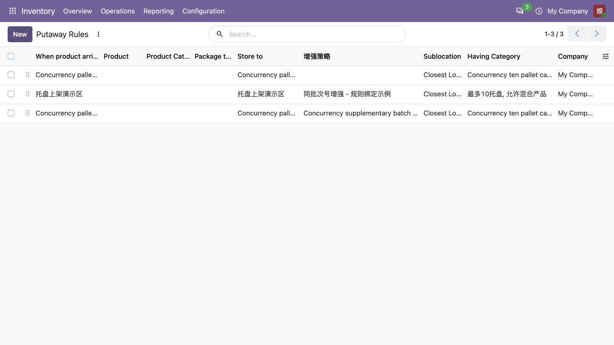

# BlueWMS

基于 **Odoo 20 社区版**的模块化仓储扩展项目，面向库存作业、可编辑上架策略，以及后续自动化仓储设备对接。

本仓库包含 BlueWMS 自研／迁移模块、保留原始归属的第三方模块、Docker 开发配置和开发文档。欢迎通过 Issue 讨论需求、报告问题，通过 Pull Request 贡献改进。

**项目状态：持续开发与迁移中。** 当前已实现库存基础保护和可编辑上架策略闭环；WCS、独立条码和云端 AI 连接处于后续规划阶段。功能范围以本仓库源码及交付记录为准。

## 当前功能

- **库存基础**：库位、容量位置、包裹及相关库存扩展。
- **库存保护**：非负库存控制、库位冻结和禁止入库，含权限与例外处理。
- **可编辑上架增强**：在 Odoo 原生上架规则中选择增强场景；人工编辑草稿，试算验证后发布，支持执行审计、版本固定及回滚。
- **系统设置优先**：原生规则、存储类别、容量和混放约束先检查，增强代码在允许范围内进一步筛选／排序。支持整托盘不拆分和跨产品同批次号限制。
- **界面与 AI 配套**：包含 MuK Web、AI、Skills 和 MCP 模块；真实模型服务需要单独配置与验证。

上架增强代码通过受限解释器处理纯数据，避免开放完整 Python 执行能力。保存草稿不会自动发布。场景、正式代码版本和执行记录存储在 Odoo 数据库中。



*截图来自隔离测试库。使用方法见 [原生上架规则与增强策略](docs/migrations/putaway-rule-binding-20.md)。*

## 模块

所有模块直接放在仓库根目录的子目录中，挂载至容器 `/mnt/extra-addons`。

| 模块 | 职责 | 许可证声明 |
|---|---|---|
| `blue_stock_base` | 库存基础扩展 | LGPL-3 |
| `blue_stock_rules` | 非负库存、库位冻结及禁止入库 | AGPL-3 |
| `blue_extension_contract` | 策略接口合同与受限解释器 | LGPL-3 |
| `blue_config_asset` | 草稿、试算、不可变版本、发布与回滚资产 | LGPL-3 |
| `blue_stock_putaway` | 原生规则绑定与上架增强执行 | AGPL-3 |
| `blue_web_theme` | 产品、包裹、库位入口及库存界面布局 | LGPL-3 |
| `blue_dev_environment` | 开发 addons 目录标识 | AGPL-3 |
| `muk_web_*` | 第三方界面组件与主题 | LGPL-3 |
| `muk_ai`、`muk_ai_skills`、`muk_mcp` | 第三方 AI、技能与 MCP 集成 | LGPL-3 |

`blue_*` 为 BlueWMS 维护的模块，其中迁移模块保留原贡献者归属。其他前缀用于第三方模块；MuK 模块保留原名称、版权头和许可证。来源与版本见 [第三方迁移记录](docs/third-party/muk-web-migration-2026-10-12.md) 和 [MuK AI 安装记录](docs/third-party/muk-ai-install-2026-10-12.md)。

## 快速开始

### 环境

- Docker 与 Docker Compose。
- Odoo 20、PostgreSQL 16.0；当前验证基线和镜像摘要见 [部署记录](docker/deployment-lock.json)。
- 本仓库模块源码。Odoo 主程序由 Docker 镜像提供，无需把官方 Odoo 源码复制到本仓库。

已记录的开发环境验证基于 macOS／Apple 芯片。其他平台或镜像架构应核对依赖并验证实际行为。

### 1. 获取源码与镜像

```sh
git clone https://github.com/bluewms/bluewms.git
cd bluewms
docker pull odoo:20.0-20260926
docker tag odoo:20.0-20260926 odoo:20
docker pull postgres:16.0
```

上述 Odoo 日期标签对应当前开发基线；镜像更新时先在隔离环境验证，再升级开发库。Compose 使用本机已有镜像并设置 `pull_policy: never`。官方镜像信息见 [Odoo Docker 镜像说明](https://hub.docker.com/_/odoo)。

### 2. 准备私有配置

```sh
export BLUEWMS_RUNTIME_DIR="$HOME/.config/bluewms20"
mkdir -p "$BLUEWMS_RUNTIME_DIR"
chmod 700 "$BLUEWMS_RUNTIME_DIR"
```

在此目录创建两个文件：

- `db-password`：一行独立的数据库强密码。Compose 将其作为 secret 提供给 PostgreSQL 和 Odoo。
- `odoo.conf`：参考下面的最小配置，把 `admin_passwd` 替换为你自己的独立强密码。它是数据库管理密码；首次创建数据库时再设置 Odoo 用户登录密码。

```ini
[options]
admin_passwd = 请替换为你自己的数据库管理强密码
db_host = db
db_port = 5432
db_user = odoo
db_name = bluewms20
dbfilter = ^bluewms20$
list_db = True
addons_path = /usr/lib/python3/dist-packages/odoo/addons,/mnt/extra-addons
data_dir = /var/lib/odoo
```

`db_password` 由容器入口从 secret 读取，这个最小配置不重复保存它。限制私有文件访问权限：

```sh
chmod 600 "$BLUEWMS_RUNTIME_DIR/odoo.conf" "$BLUEWMS_RUNTIME_DIR/db-password"
```

此配置用于本机开发。仓库不提供共享管理员账号、默认登录密码或公共业务数据库。

### 3. 启动并安装模块

```sh
docker compose -f docker/compose.yaml up -d
docker compose -f docker/compose.yaml ps
```

打开 [本机 Odoo](http://localhost:8070)。首次使用时创建名为 `bluewms20` 的数据库并设置自己的登录账号；若入口提示数据库未创建，可访问 [数据库管理页面](http://localhost:8070/web/database/manager)。

登录后进入应用，按需安装 `blue_stock_base`、`blue_stock_rules`、`blue_stock_putaway` 等模块，依赖由 Odoo 自动安装。搜索技术模块名时可以移除默认的“应用”筛选。MuK 模块按需选择；AI 使用还需要模型提供方配置。

如果已有开发库，使用配套数据库与 filestore 备份恢复，保留原库名，不要重新初始化覆盖。数据库和附件分别由 `bluewms20-postgres-data`、`bluewms20-odoo-data` 数据卷持久保存。

详细升级、备份及多台电脑操作见 [Docker 开发说明](docker/README.md) 和 [Git 同步说明](docs/git-sync.md)。以后启动时需继续设置 `BLUEWMS_RUNTIME_DIR`，或通过私有 `--env-file` 传入当前用户目录。

## 开发与验证

功能按独立任务分支开发，提交应说明问题、修改范围和验证结果。模块结构或数据发生变化时，更新相应模块版本并执行升级；Python 修改后重启 Odoo。

2026-10-12 的交付记录包含：

- 库存与策略相关 **120 项联合测试**，其中 **77 项上架测试**；独立事务并发测试验证最后一个托盘位只能由一个作业成功分配。
- MuK AI 系列 **309 项后端／HTTP 测试**及前端资源编译验证；实际模型对话与云端业务连接待配置、验证。

这些是记录中的开发基线结果。测试范围、边界、源码摘要和运行方式见 [上架交付记录](docs/migrations/putaway-rule-binding-20.md)、[库存规则记录](docs/migrations/stock-rules-20.md) 和 [MuK AI 记录](docs/third-party/muk-ai-install-2026-10-12.md)。

数据库中的策略资产、业务记录和附件不通过 Git 同步；Git 管理模块代码、模板、部署说明及开发文档。

## 参与贡献

欢迎提交缺陷、文档修正和功能建议。

- **报告问题**：在 [Issues](https://github.com/bluewms/bluewms/issues) 中提供 Odoo／模块版本、复现步骤、预期与实际结果，以及已脱敏的日志。
- **提交改进**：从任务分支发起 [Pull Request](https://github.com/bluewms/bluewms/pulls)，描述改动目的、影响范围和验证方式。功能变化需更新相关文档，并对关键行为提供验证。
- **开发约定**：后端采用 Odoo ORM、权限与视图规范；前端遵循对应版本的 Owl／Web 规范。AI 辅助开发可参考官方 Odoo 源码中的 guidelines、review、security skills，人工贡献同样欢迎。
- **第三方修改**：保留作者与许可证，记录来源和本地变更；升级第三方模块时核对兼容性。

请勿提交真实密码、API key、客户业务数据、数据库备份或私有附件。

## 后续方向

- `blue_wcs_*`：自动化设备接口、作业执行与 WCS 协同。
- 独立条码模块：与库存基础模块分开规划。
- AI 草稿生成：对接云端知识／记忆服务，将需求与示例代码转换为可验证草稿；本地保留试算、发布、执行和回滚控制。
- 持续完善 Odoo 20 迁移、测试及部署文档。

进展与范围见 [开发规划](docs/planning/bluewms20-development-plan.md) 和 [模块架构](docs/planning/bluewms20-module-architecture.md)。规划能力在实际交付后再加入“当前功能”。

## 许可证与来源

本仓库包含 **AGPL-3 与 LGPL-3 模块**，各模块采用自己的许可证声明。具体文本及归属以模块 `__manifest__.py`、`LICENSE` 和适用的 `NOTICE.md`／版权头为准。

- BlueWMS 库存规则保留相关 OCA／原贡献者归属，见 [来源说明](blue_stock_rules/NOTICE.md)。
- MuK 模块保留 MuK IT 的原始归属，见 [上游说明](docs/third-party/MuK-upstream-README.md) 和 [许可证文本](docs/third-party/MuK-LICENSE)。

Odoo 主程序是独立上游项目；本仓库的模块声明不替代上游及依赖组件的许可证。

## 维护与联系

由 **宁波宝蓝物流科技有限公司**维护。

项目讨论优先使用 GitHub Issues／Pull Requests。业务联系：[bluewms.com](https://www.bluewms.com) · [blue.lang@outlook.com](mailto:blue.lang@outlook.com)。
