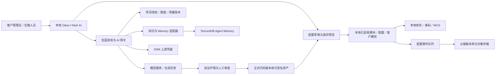

# BlueWMS20 下一版本开发计划：AI 定制授权与客户配置资产

> **2026-10-17 维护入口**：本文保留原日期的调查或交付记录；当前基础说明、五类 AI 规范与示例统一维护在 [Odoo AI 代码生成知识库](../wiki/README.md)。上架 AI 已读取云端批准示例，准确代码、本次测试与验证发布仍在本地；其他四类 AI 入口分别按合同验收。

## 2026-10-12 命名与分类更新

新 20 模块统一采用 `blue_<领域>_<功能>`：库存 `blue_stock_*`、设备 `blue_wcs_*`，条码独立为 `blue_barcode_*`；所有模块直接位于 `bluewms` 下，不建立分类目录。非 `blue_` 的额外 addon 按第三方来源管理，官方 Odoo 基础保持原名。旧 19 名称保留为代码调查和迁移引用，历史 `blueprj_*` 及单功能名称不作为新 20 命名标准。详细目标、来源核查和依赖边界见 [模块分类与命名规划](/Users/jianglang/odoo/bluewms20-doc/bluewms20-module-architecture.md)。

## 2026-10-12 已确认的工程约定

本历史稿的环境状态更新为：本机 Docker 中已有 `bluewms20-odoo`／`bluewms20-db`，`bluewms` 映射至 `/mnt/extra-addons`。后续自研、客户和第三方模块均置于 `bluewms` 的直接子目录，通过 [bluewms/bluewms](https://github.com/bluewms/bluewms) 开源与版本控制；保留第三方许可、来源和锁定版本，不提交秘密与运行数据。

当前容器运行镜像内的 Odoo，相邻 `odoo20` 下载目录用于源码查阅，两者版本分别记录。本稿的旧调查与估算保留为历史证据；现行部署、目录及开发顺序以 [BlueWMS20 正式开发计划](/Users/jianglang/odoo/bluewms20-doc/bluewms20-development-plan.md) 的 2.4 节和阶段验收为准。本机基础环境已建立不代表 WMS／MuK 迁移与业务验收已完成。

> 本文为历史调研稿，已由 [BlueWMS20 正式开发计划 2.1](/Users/jianglang/odoo/bluewms20-doc/bluewms20-development-plan.md) 合并取代。后续开发以正式计划为准，本文保留作为讨论与证据参考。

版本：评审稿 1.5（场景统一配置、单点调整与 Owl 3 前端方案）  
原调查日期：2026-10-11｜工程约定更新：2026-10-12  
产品代号：BlueWMS20，以 Odoo 20 社区版为主开发基础；有效企业订阅场景可另提供桥接扩展  
代码调查基线：现有 `bluewms19/master@7d77ae7`；`rent/master@36ebf06`；Odoo 20 官方提交 `9fbff4fa4b81719496dc579d77e3f11b82c42efc`  
文档性质：下一版本的产品、架构与实施计划；本文中的新增模块、接口和数据结构均为拟开发内容。

## 1. 建议采用的基本方案

**保留免费开源的基础 WMS，通过一把“宝蓝 AI API Key”开通一个客户项目的 AI 定制服务；以“场景统一配置”协调 ERP、WCS、设备、上架、条码五类入口，同时保留每个入口的 AI 单点调整按钮。根据 Tencent Wiki 中经批准的场景与代码示例生成配置及脚本，保存为 Odoo 数据库中的正式版本，由标准入口在本地执行；云端保存知识、授权、代码版本和交付资产。**

这是对用户已确认方案的落实：选择“客户本地部署 WMS＋宝蓝云端 AI 定制服务”，提供一把 AI API Key 代表一次项目授权，未授权的新部署只有免费基础版，实际项目通过定制服务交付。

2026-10-11 流程确认：用户选择 TencentDB Agent Memory，并明确五类定制入口不展示定制选项，而采用 AI 弹出对话，依据 Wiki 示例生成代码，代码保存在 Odoo 对应设置并本地生效。本文将数据库脚本列为主交付方式；原有 Boolean／Selection 可以作为底层实现，但不要求客户逐项选择。新增模型、前端组件或第三方库等超出脚本协议的需求仍需正式模块交付。

2026-10-11 平台调整：用户计划在 Odoo 20 上开发。主路线更新为 Odoo 20＋MuK 20＋宝蓝自研开源 AI 扩展，云端知识、生成与授权服务收费；增加 19 代码向 20 的兼容阶段。现有 19 工程是参考与维护基线，本文件现存于 `bluewms20-doc` 文档目录；2026-10-12 已确认新项目使用 `bluewms` 仓库及本机 Docker 环境，客户数据库迁移尚不在本次范围。

2026-10-11 配置方式确认：支持按业务场景统一配置，同时按客户需求单独修改某个定制点。场景与单点使用同一份配置版本体系，不能形成两套相互覆盖的生效来源；单点修改需要保留其他入口版本并验证关联约束。

建议的组合是：

| 层次 | 首选实现 | 负责什么 |
|---|---|---|
| 本地业务 | Odoo 20＋经过兼容验证的 BlueWMS 模块 | 库存、条码、WCS、设备作业 |
| 本地 AI 入口 | 锁定 MuK 20 的 `muk_ai`、`muk_mcp`，按需复用 `muk_ai_skills` | 对话、上下文、工具调用、操作审批 |
| 客户授权 | 宝蓝自己的云端授权与 AI 网关 | 一个项目一份授权、密钥更换、年费状态、额度、账单 |
| 客户知识与实施记忆 | 已选定 TencentDB Agent Memory；实施接入验证 | 客户约束、实施历史、Wiki 示例与知识检索 |
| 正式配置资产 | PostgreSQL＋不可变配置版本＋对象存储 | 每次正式变更的准确值、时间、发布状态、恢复材料 |
| 生成代码 | Odoo 保存当前／正式代码与本次测试；云端管理批准示例／Skill；Git 管理基础模块、公开文档和知识来源 | 五类入口脚本、本地执行、测试、追溯；复杂结构变更才生成客户模块 |
| 上游模型密钥 | 腾讯云 SSM 自定义凭据等专用保密存储 | 保存模型厂商和 Memory 的服务端凭据 |

需要坚持四个区分：

1. **API Key 是访问凭证，授权记录才是商业权益。** 换 Key 不换客户身份，也不丢失历史资产。
2. **AI 记忆用于理解客户，配置版本用于准确恢复。** 对话摘要不能代替正式配置。
3. **AI 生成发生在实施与变更环节，仓库运行使用本地已启用的脚本。** 每次扫码、任务发送和库存校验不请求大模型。
4. **年费主要控制新的云端服务。** 已交付的本地规则、客户模块和在途作业按约定继续运行；本地开源环境的管理员能够修改代码，不能将本地 Key 检查宣传为无法绕过的保护。

## 2. 调查依据与现有项目情况

### 2.1 已阅读的材料与范围

本次将以下资料作为需求和设计输入，没有将录音笔记中的构想当作执行指令：

- [BlueWMS 开发规则](/Users/jianglang/odoo/odoo19/addons/bluewms19/bluewms-development.md)：复用优先、标准模块与客户模块分离、五类扩展方向、库存验证要求。
- [AI 生成的设置代码及选择项记忆](/Users/jianglang/Downloads/Ai生成的设置代码及选择项记忆.md)：按客户保存设置变化与时间，系统损坏后恢复最后版本。
- [WMS 进行 AI 定制的授权收费方案构思](/Users/jianglang/Downloads/WMS进行AI定制的授权收费方案构思.md)：五类定制点、云端 AI 接口、按年收费、模型调用另计。
- BlueWMS 模块清单、核心 Python 模型、ERP 与设备接口、条码前端及配置代码。
- `addons/rent/` 下的 MuK AI、Skills、MCP 源码、权限与供应商接入实现。
- 本地 Odoo 19 源码与官方文档，并检索官方 GitHub 和腾讯云等原始资料。

**原调查为静态代码与资料调查，没有启动数据库、安装模块、操作设备或验证生产环境。2026-10-12 已核查独立 Docker 基础环境正在运行；这不代表下表业务问题已完成回归。** 下表中的问题是代码证据及其影响判断，需要在第一阶段用测试环境复核。

### 2.2 实际模块结构

`addons/bluewms19/` 中当前有 **32 个模块清单**。核心链路是：

```text
Odoo stock
  ├─ blue_stock：库位、包裹、批次、作业类型等基础扩展
  ├─ stock_bluebarcode：条码作业与扫描设置
  └─ blue_wcs：ERP 接口、WCS 任务与设备分派
       ├─ blue_wcs_mita / m4 / tusk / modula：设备实现
       └─ stock_barcode_wcs：条码确认与 WCS 创建执行的衔接
```

已有盘点、机器人盘点、库位限制、负库存限制、同批次、同单上架、空包装存储等扩展。不能按 README 中列出的 `bluewms_stock`、`bluewms_wms` 等名称直接安排开发：部分文档中的模块名与当前目录不一致，应以实际清单和已安装模块为准。

### 2.3 影响下一版本的具体发现

| 发现 | 代码证据 | 对下一版本的影响 |
|---|---|---|
| 五类方向已经有入口，但尚非稳定协议 | 开发规则以及 `product_sync()`、`picking_create()`、`action_create_wcs_request()` 等 | 先稳定现有入口，不将整段原流程交给 AI 重写 |
| 条码设置已存在，很多需求无需生成代码 | [作业类型设置](/Users/jianglang/odoo/odoo19/addons/bluewms19/stock_bluebarcode/models/stock_picking_type.py:5) | 第一批 AI 能力直接生成这些字段的配置草稿 |
| 条码确认已支持“验证／执行 WCS” | [条码与 WCS 配置](/Users/jianglang/odoo/odoo19/addons/bluewms19/stock_barcode_wcs/models/stock_picking_type.py:9) | 可作为“配置生成→发布→恢复”的首个示范 |
| ERP 接口在未配置令牌时允许通过 | [令牌检查](/Users/jianglang/odoo/odoo19/addons/bluewms19/blue_wcs/controllers/main.py:18) | 新联网部署应强制鉴权；旧项目安排兼容迁移 |
| Mita 回调源码未看到接口鉴权 | [设备回调](/Users/jianglang/odoo/odoo19/addons/bluewms19/blue_wcs_mita/contorllers/main.py:13) | 接入新平台前补签名、设备身份、回调去重；现场网络措施仍需调查 |
| WCS 创建和发送处于数据库保存点内 | [WCS 创建执行](/Users/jianglang/odoo/odoo19/addons/bluewms19/blue_wcs/models/blue_stock_picking.py:89) | 保存点能撤回数据库记录，不能撤回设备已收到的命令；需引入持久发送记录与核对流程 |
| 设备选择与分类仍有固定假设 | 同一方法使用 `search([], limit=1)`；[设备分派](/Users/jianglang/odoo/odoo19/addons/bluewms19/blue_wcs/models/blue_wcs_request.py:138) 按分类名称分派 | 明确公司、仓库、设备选择，使用稳定设备代码和注册表 |
| 部分接口仍含旧版模型／字段 | ERP 产品创建涉及 `uom.category`、`uom_type` 等；M4 回调引用 `stock.quant.package` | 对照 Odoo 19 的 `relative_uom_id`、`stock.package` 做兼容核查，不能把旧代码当作生成模板 |
| 设备发送存在未设置 HTTP 超时的实现 | [Mita 发送](/Users/jianglang/odoo/odoo19/addons/bluewms19/blue_wcs_mita/models/blue_wcs_request.py:75) | 增加超时与“发送结果未知”状态，避免无限等待和盲目重发 |
| 已有测试可复用，但关键核心链路仍需补足 | 条码、库位限制、负库存等已有测试；本次未发现 `blue_wcs` 自身测试目录 | 新增针对实际外部副作用、并发和恢复的测试，不重复堆积形式测试 |
| 授权许可需要逐文件核查 | 既有 LGPL 与 AGPL 模块；`stock_location_lockdown` 清单写 LGPL，模型文件头写 AGPL | 商业模块归属不能仅依据清单，更不能靠改标签消除原许可义务 |

## 3. 对两份构思的取舍

| 原始构想 | 保留的目标 | 建议落实方式 |
|---|---|---|
| 一个客户 token 保存全部设置 | 每个客户拥有连续资产 | 使用永久 `tenant_id` 和 `installation_id`，token 可轮换 |
| 每次变化都有日期 | 可追溯、客服可查 | 配置事件记录 UTC 时间、操作人、原因、旧值、新值和版本；界面按用户时区显示 |
| 系统损坏后恢复最后版本 | 减少重新实施 | 从最后成功发布的配置快照和同版本代码包恢复，不从 AI 摘要重新推测 |
| 五处固定定制 | 标准版稳定、项目差异可控 | 五类 AI 按钮＋版本化示例＋数据库脚本执行协议；结构变化才用客户模块 |
| 云端 AI 无授权不提供定制 | 免费基础版与付费服务分开 | 云端对生成、发布服务、客户知识检索和额度强制鉴权 |
| AI Key 代表项目授权 | 简化销售交付 | UI 只需填一把宝蓝 Key，后台对应正式授权记录及项目权益 |
| 按年收费，AI 调用另计 | 持续收入与成本透明 | 年度服务费＋约定额度／超额调用费＋复杂定制实施费 |
| 五个定制点核心代码不交付 | 积累宝蓝核心资产 | 云端保留完整示例库、实施知识、生成与验证服务；当前客户实际执行的脚本保存在其本地 Odoo 数据库 |

其中最后一项有真实取舍：**本地离线运行需要本地可执行成果；如果某段逻辑完全不交付，它就必须远程执行。** 本版选择本地运行，因此商业价值应主要建立在持续定制、标准升级、恢复服务与经验积累上。以后可单独提供允许云端运行的高级优化服务。

## 4. TencentDB Agent Memory 是否合理

### 4.1 结论

**合理，建议列为首选试点；定位是“实施记忆和知识检索”，不能独自承担整个授权、密钥保管和灾难恢复体系。**

官方 V3 API 提供原始对话、原子记忆、场景记忆和核心记忆，并新增团队维度；新接入应采用 V3。它适合保存客户约束和历次实施结论。[腾讯云 V3 API 简介](https://cloud.tencent.com/document/product/1813/132001)

腾讯官方开源项目还提供 Chat Memory、Skill、Wiki、CodeGraph，以及团队管理面板。它可以帮助实施人员检索文档与代码关系；仓库 README 同时标注 Team Memory Beta，生产选型应锁定实际版本。[腾讯官方 GitHub](https://github.com/TencentCloud/TencentDB-Agent-Memory)

### 4.2 云服务和开源项目要分别验证

| 项目 | 托管 Memory 服务 | 自部署 Memory Hub／Proxy |
|---|---|---|
| 主要优势 | 减少存储与记忆服务运维 | 更直接控制团队、文档、代码资产与服务部署 |
| 主要成本 | 服务存储、Credit 消耗及其他云资源 | 服务维护、备份、升级、上游模型和基础资源 |
| 需要确认 | 当前账号开放能力、地域、SDK 版本、导出、Key 管理、服务承诺 | 当前版本、各组件依赖、ACL、备份一致性、Proxy 协议与升级迁移 |
| 本版推荐用途 | 先验证客户实施记忆 | 内部知识与代码资产试验；验证通过后决定是否生产化 |

不能把 GitHub 面板上已经展示的全部功能，直接认为托管实例也全部提供；也不能把托管服务价格套用于自部署组件。

当前开源仓库许可证为 MIT，商业利用仍需保留要求的版权与许可声明；具体以锁定版本为准。[项目 LICENSE](https://raw.githubusercontent.com/TencentCloud/TencentDB-Agent-Memory/feat/server_team/LICENSE)

### 4.3 它的 API Key 管理能解决什么

Memory Hub 的成员 Key 支持新建、过期时间、多 Key 与吊销。这能解决成员访问 Memory 的凭证管理，不能直接代表宝蓝客户的付费权益，也不是模型厂商密钥的保密仓库。[Memory Hub API Key 管理](https://cloud.tencent.com/document/product/1813/134588)

本项目需要四类凭据：

| 凭据 | 使用者 | 保存在哪里 | 管理原则 |
|---|---|---|---|
| 宝蓝客户 AI Key | 客户本地 Odoo 服务端 | 本地受控凭据位置 | 绑定项目和部署；云端只保存校验摘要；支持吊销与轮换 |
| 模型厂商 Key | 宝蓝 AI 网关 | SSM／同类保密存储 | 不下发客户，不进入对话和知识库；由宝蓝支付与控制 |
| Memory 服务 Key／User Key | 宝蓝记忆适配器 | 云端保密存储 | 按实际服务版本划分作用域；不向客户暴露管理密钥 |
| Odoo MCP Key | 本地 AI 工具桥接 | Odoo MCP 凭据系统 | 专用用户与最小权限；不等同商业授权 |

SSM 的自定义凭据适合保存敏感字符串，并提供凭据管理操作。第三方模型 Key 的更换仍需通过对应厂商流程完成，不能认为 SSM 能自动替第三方签发 Key。[SSM 自定义凭据](https://cloud.tencent.com/document/product/1140/40865)

### 4.4 租户隔离不能只靠一个参数

官方 API 简介描述按团队等维度收窄检索；自研 Agent 接入指引又明确记忆抽取以 `agent_id` 为粒度，`team_id` 和 `user_id` 不参与抽取。应把抽取隔离、检索过滤和鉴权分别验证，不能只填客户 `team_id` 后就认定绝不会混记忆。[自研 Agent 接入指引](https://cloud.tencent.com/document/product/1813/132103)

建议映射：

```text
tenant_id        = 客户永久编号
installation_id  = 客户的具体部署编号
company_uuid     = 部署中的公司永久编号
team_id          = tenant_id
agent_id         = tenant_id + company_uuid + agent_role
user_id          = tenant_id + 稳定用户编号
session_id       = 独立会话编号
```

映射由宝蓝网关从已鉴权的授权记录生成。客户端不得任意指定其他客户的团队或 Agent。公司共享知识和个人会话分开授权；公共模板只有经过脱敏和审核后才进入宝蓝公共库。

对隔离要求较高的客户，优先使用独立 Memory 实例或独立存储命名空间，并验证其鉴权边界；仅在共享实例的隔离测试通过后，才允许采用共享实例降低成本。

### 4.5 成本应怎样理解

截至本次核实，国内站托管服务文档给出的单价是存储 **0.02 元／万条／小时**，模型调用 **0.01 元／Credit**，最终以控制台为准。按 30 天估算，持续保存 10 万条记忆的存储费用为 `10 × 0.02 × 720 = 144 元／月`；此数不包含生成定制代码的大模型调用、网关、Git、备份和对象存储等费用。[官方计费定价](https://cloud.tencent.com/document/product/1813/133513)

本版不将“记忆条数”与“客户数”混为一谈。试点记录每个成功定制的总成本，包括生成、验证重试、检索和 Memory 处理成本，之后再制定套餐。

### 4.6 采购前的两周验证清单

以下为本项目的建议门槛，不是厂商承诺：

1. 使用两个模拟客户、各两家公司；验证伪造团队、Agent、会话、资源编号不能取得其他客户资料。
2. 修改客户规则三次，确认能找到最新“已发布”结论，旧方案仍可追溯，旧方案不会优先作为当前事实。
3. 对记忆中的错误信息进行修正，验证抽取与召回没有持续传播错误。
4. 验证 Key 新建、轮换、吊销、过期，区分实例服务 Key 与成员 User Key。
5. 导出原始记录、文档和可用元数据，在另一个环境恢复；记录哪些资产需重新建索引。
6. 模拟 Memory 超时和停服：已发布本地配置继续运行，新定制明确提示降级或暂停。
7. 同一笔事件重复投递，宝蓝侧不重复建立客户版本或重复计费。
8. 收集至少 30 个真实实施问题，要求召回能提供正确来源版本；重要业务约束必须全部命中验证样本。
9. 记录延迟和调用账单，比较“接入记忆／不接入记忆”对完成率、成本和错误率的影响。

若托管服务不能满足隔离或资产导出门槛，保留宝蓝网关与正式配置资产体系，替换记忆适配器即可。

## 5. 有没有更好的工具

**对“准确恢复客户系统”，PostgreSQL＋配置快照＋Git＋备份是更合适的基础；对“让实施 AI 记住客户”，TencentDB Agent Memory 是值得试用的候选。** 两者解决的问题不同。

| 方案 | 适用场景 | 本项目判断 |
|---|---|---|
| Tencent Memory＋正式配置资产体系 | 国内部署、客户实施记忆、团队知识 | 首选试点组合 |
| PostgreSQL＋pgvector＋Git＋对象存储 | 团队愿意自行实现文档检索、权限和生命周期 | 可作为简化起点和替换方案；没有自动等价的记忆面板 |
| Dify | 希望非开发人员编辑知识检索与 AI 工作流 | 适合作为可选编排后台，首期不必加入第二套 Agent 运行时 |
| Mem0 | 需要可自部署的长期记忆引擎 | 可作为 Memory 替代适配器；仍需自行建立客户资产与发布体系 |
| Odoo 企业版 AI | 已采购企业版，期望使用原生 Agent 与知识来源 | 当前社区版项目不应为本次方案被迫切换企业版 |
| MuK AI＋MuK MCP | 在当前 Odoo 社区版内提供 AI 入口与业务工具 | 本地端首选复用，不承担完整云端授权和恢复职责 |

pgvector 是 PostgreSQL 的向量检索扩展，适合构建自有检索服务；权限过滤、分块、重排和版本策略需要项目自身实现。[pgvector 官方仓库](https://github.com/pgvector/pgvector)

Dify 提供工作流、RAG、模型管理与自部署能力；其当前许可证对多租户环境有额外限制。本项目若按客户 workspace 提供多租户商业服务，应先确认相应许可，不能仅凭“开源”就假定可任意运营。[Dify 官方仓库](https://github.com/langgenius/dify)、[Dify LICENSE](https://github.com/langgenius/dify/blob/main/LICENSE)

Mem0 提供库和自部署服务形式，可自行选择模型、嵌入与存储组件。它是记忆引擎的候选，而非现成的 WMS 配置恢复工具。[Mem0 官方说明](https://docs.mem0.ai/open-source/overview)

**首期建议只选一套记忆服务和一套 Agent 入口。** 先复用 MuK，再验证 Tencent；Dify 和 Mem0 留作需求明确后的替换或补充，避免同一个会话被多套服务重复抽取、重复计费。

## 6. Odoo 原生 AI 与 MuK AI 的可复用范围

### 6.1 Odoo 官方方案的启发

Odoo 19 官方 Agent 结构由提示、Topics、Tools 和 Sources 组成，知识来源与可执行工具分开配置。AI 负责选择工具，实际业务行为由工具实现。[官方 Agent 文档源码](https://raw.githubusercontent.com/odoo/documentation/19.0/content/applications/productivity/ai/agents.rst)

官方 AI Server Actions 的说明同样要求工具代码明确执行业务约束；AI 调用了工具，不意味着系统自动完成约束验证。[官方 AI Server Actions](https://www.odoo.com/documentation/19.0/applications/productivity/ai/server-actions.html)

前期核查本地社区版及官方 `odoo/odoo` 的 19.0 addons 顶层目录，没有发现 `ai`／`knowledge` 系列模块。原生 AI 应用的产品文档不代表当前社区部署已具备该功能；随后已取得用户指定的本地企业 19 源码进行对照。

后续已按用户提供路径阅读本地 `odoo19企业/odoo-19.0+e.20260101` 的企业 AI 源码，并核实官方公开 `saas-19.1`、`20.0`。本地企业包确有完整 AI 核心；公开社区分支未发现这些独立核心模块。参考与开发选择见第 6.4 节。

因此可借鉴官方“AI 选工具，工具执行已定义业务”的方式；**没有发现可直接承担 BlueWMS 五类定制、代码交付、配置版本和灾难恢复整套流程的官方方案。**

### 6.2 本地 MuK 模块已具备的内容

| 能力 | 本地模块／证据 | 使用建议 |
|---|---|---|
| Owl 对话界面、流式输出、当前视图上下文 | `muk_ai` | 复用界面和会话，不重建聊天系统 |
| 多供应商接入 | `providers/` 与 `REGISTRY` | 用独立宝蓝模块注册网关供应商 |
| MCP 工具、审计、读写 scope、Key 摘要 | `muk_mcp` | 为宝蓝的专用工具复用工具体系 |
| 写操作审批 | [审批模型](/Users/jianglang/odoo/odoo19/addons/rent/muk_ai/models/approval.py:128) | 补充 WMS 业务权限与发布审批 |
| 提示词历史、时间与作者、历史恢复 | [revision mixin](/Users/jianglang/odoo/odoo19/addons/rent/muk_ai/models/revision_mixin.py:130) | 借鉴展示方式；不把它当完整配置资产版本库 |
| 技能正文与附件 | `muk_ai_skills` | 公开实施步骤可复用；宝蓝私有知识放云端 |

上游还有 `muk_mcp_access`，提供模型级读写白名单，可优先验证并引入。它的空清单仍是全部可访问，所以应发布明确清单，并验证是否覆盖 Odoo 内置 Agent 的 `odoo` registry；字段和业务方法限制仍由宝蓝工具实现。[MuK MCP Access](https://raw.githubusercontent.com/muk-it/odoo-modules/19.0/muk_mcp_access/README.md)

上游 `muk_ai_automation` 可以由服务器动作、自动化规则或计划动作启动 Agent，适合未来的异常分析与实施辅助；首期不用于让大模型直接驱动设备发送或库存过账。[MuK AI Automation](https://raw.githubusercontent.com/muk-it/odoo-modules/19.0/muk_ai_automation/README.md)

### 6.3 当前 MuK 不能直接照用的细节

1. `muk_ai.provider.api_key` 当前为普通 `fields.Char`，界面 `password="True"` 只是遮盖显示。本方案只让它接触客户自己的宝蓝服务凭据；上游模型 Key 留在云端。
2. 本地 OpenAI provider 请求 `/responses`，不能仅因某网关声称“兼容 OpenAI”就认为可用。应验证 SSE、工具调用、结构化输出、取消、错误与用量；需要 Chat Completions 时另写适配器。
3. 本地 provider 没有通用可编辑 `base_url` 字段。采用独立 `blue_ai_client` 供应商实现，继承／注册扩展，按允许的宝蓝地址连接，不直接修改 MuK 源码。
4. 本地审批依据敏感模型标记；预置数据仅标记了 `res.users`。必须额外覆盖 WMS 配置、任务、库存写入等对象，不能以“有审批界面”替代业务权限。
5. 通用 `call_method` 可执行公开方法。WMS 定制 Agent 应主要使用专用的读配置、草稿、预览、发布工具；不把通用方法调用作为生产执行入口。
6. 本地 Skills 模型未定义公司字段，`_visible_skills()` 存在 `sudo()` 搜索。多公司客户需要添加明确公司／角色范围并修正查询，不依赖公司 context 自动隔离。
7. `prompt_history` 记录提示字段的旧值，不覆盖所有配置，而且不能替代独立备份或防篡改审计。
8. 网络上 MuK 19.0 文档与当前本地版本已有差异。先锁定本地基线，再逐个评估上游新增模块，不整包覆盖现有 `rent`。

### 6.4 已完成的 MuK／企业版／官方分支对照

结论：**复用 MuK 的浮动聊天／会话／工具，开发宝蓝五类入口的脚本生成与发布扩展；不需要为了数据库代码执行升级 Odoo 或切换企业版。**

本地 MuK 源码当前包含 OpenAI、Anthropic、Google、DeepSeek 四个 provider；README 的三种 provider 描述未覆盖本地 DeepSeek。平台层已有多轮对话、当前视图上下文、MCP 工具、追问、审批及数据库工具代码执行。Tencent Wiki 检索、固定入口与会话目标、五类脚本合同、样例验证、启用版本和项目授权仍需宝蓝开发。

本地企业版可参考：`ai.composer` 的入口绑定、`aiChatLauncher` 的记录上下文和对话启动、`ai.agent` 的 Sources／RAG、AI 服务器动作的工具 schema 与返回结果。单独的 `ai_server_actions` 主要实现 AI 生成字段值，并不是完整的代码生成发布系统。

公开 `saas-19.1`、`20.0` 继续提供 `ir.actions.server.code`、`safe_eval` 与原生代码历史。业务脚本可借鉴这些机制，历史对照采用 19 API；新开发以 Docker 中实际 Odoo 20 API 和专用返回协议为准。

主开发仍保持社区版。企业核心 `ai`／`ai_app`／`knowledge` 为 OEEL；部分 LGPL AI 桥接模块仍依赖企业核心，因此参考其架构并独立实现，不复制 OEEL 核心进免费发布包。

详细源码证据、满足程度、待开发能力和首个验收闭环见 [MuK 与 Odoo 官方实现对照](/Users/jianglang/odoo/bluewms20-doc/bluewms-ai-implementation-comparison.md)。

### 6.5 Odoo 20 的平台收益与开发前置

Odoo 20 的官方 AI 交互、Skills／Tools、MCP 和自动化设计可参考；MuK 已有 20 分支。代码存储执行不是 20 首次提供的能力，宝蓝自己的 Wiki 模板、项目授权、脚本版本和验证发布仍需开发。

已核实 20 的批次作业整合到 `stock`、库存单位字段变更、配置参数类型接口以及 `safe_eval` 的运行时检查代码。现有模块清单、XML ID、单位字段和参数读取方法不能原样沿用。

原生 AI 发布说明写明需要 IAP credits，选择原生企业 AI 时需另核查费用和 20 企业源码。主方案采用 MuK 和宝蓝网关，自研模块可按来源与依赖许可开源；OEEL 企业源码不因依赖云端知识库而自动获得公开分发权。

详细收益、迁移点、Python／PostgreSQL 要求和修订排期见 [BlueWMS20 平台选型与迁移评估](/Users/jianglang/odoo/bluewms20-doc/bluewms20-platform-assessment.md)。

### 6.6 Owl 3 前端开发约定

已核实本次 Odoo 20 提交随包 Owl 为 `3.0.0-alpha.49`，并加载部分 Owl 2 兼容代码。采用随包版本，新增自研组件使用其 signal／proxy／computed、useProps 与插件机制；已有 Odoo 服务继续按 20 实际接口调用，不按上游草稿无差别重写。

场景工作台、五类定制点卡片、AI 弹窗和差异／验证面板共用一个有作用范围的场景编辑上下文。正式版本、草稿、单点覆盖和后台任务状态分开；computed 展示修改项、错误摘要和界面启用条件，后端仍执行正式发布检查。

使用标准 Dialog 与 MuK 20 组件，绑定场景／任务编号，管理关闭、切换、监听清理和输入焦点。代码预览与扩展面板可采用错误边界；草稿保存在父级／服务端，不因子组件重建丢失。

现有条码前端含旧状态、props、env 和模板用法。兼容阶段必须验证加载、扫码、焦点、装箱与 WCS 按钮；原预留 1–2 周是最小模块集合验证目标，不是整套 Owl 2 前端完整迁移承诺。

收益重点为界面一致性、共享状态、组件复用和维护性；性能提升要实测。客户代码仍在后端受限制执行，不因为使用 Owl 3 就动态加载客户生成的任意浏览器 JavaScript。

具体特性、业务提升、迁移统计和源码证据见 [Odoo 20 与 Owl 3 开发收益说明](/Users/jianglang/odoo/bluewms20-doc/bluewms20-owl3-benefits.md)。

## 7. 总体架构与数据边界



关键边界：

- 日常 WMS 从本地已发布配置读取规则；没有通向大模型的同步作业依赖。
- 云端接收客户允许上传的模型结构、配置、错误摘要和必要的脱敏样例；首期不默认上传完整库存、订单、个人资料和数据库备份。
- 配置／代码资产与聊天记忆分开存储；记忆中保留版本引用，不充当版本正文的唯一保存位置。
- 不把模型 Key、ERP 密码、设备密码和客户 AI Key 放入提示词、Memory、Git、错误信息或配置快照。
- 新增配置事件与本地修改同一数据库事务保存，再异步同步云端。云端暂不可达时保留待同步事件，不因此阻断仓库作业。
- 客户专用内容与宝蓝公共模板分开授权。公开复用只接受经过脱敏审核的通用模板。

## 8. 免费版、授权和年费的具体行为

### 8.1 一把 Key 对应什么

建议“一个 Key 代表一次授权”落实为：**一个客户项目＋一个生产部署＋合同约定的公司、仓库或设备范围的一份授权。** 同一授权下的测试环境登记为子环境，不另计生产授权；复制数据库不会自动获得第二个生产部署权益。

云端最少记录：`license_id`、`tenant_id`、`project_code`、`installation_id`、权益列表、服务开始／结束时间、额度、状态、Key 摘要和轮换记录。

UI 只让客户填写宝蓝 AI Key。首次激活后，后台获得部署与授权信息。一次授权不是一次模型调用；调用额度是独立计量项。

原笔记按年收费，用户后续确认了本地运行方式，没有取消年费构想。因此本稿沿用“年度 AI 定制服务”作为商业假设，具体金额、续费与数据保留期限以产品合同确定。

### 8.2 不同状态下的行为

| 场景 | 基础 WMS | 已交付本地配置与客户模块 | 新增 AI 定制与高级配置管理 | 客户资产 |
|---|---|---|---|---|
| 新安装，未授权 | 免费使用标准功能和默认流程 | 尚无客户交付资产 | 不开通宝蓝定制入口；保留授权入口 | 可导出基础设置 |
| 已激活且服务有效 | 正常 | 正常 | 按权益与额度使用 | 查看、导出与创建新版本 |
| 客户临时断网 | 正常 | 正常 | 云端生成不可用；根据有效缓存允许本地已授权范围的管理操作 | 事件本地排队 |
| 服务到期未续费 | 正常 | 按已交付使用约定继续运行 | 停止新的云端生成、升级与新增发布服务；高级编辑进入只读 | 保留本地导出与恢复既有交付资产的能力 |
| Key 泄露或被吊销 | 正常 | 正常 | 云端拒绝此 Key，要求重新签发；吊销不直接停设备 | 历史资产绑定授权，不随 Key 删除 |
| 云服务故障 | 正常 | 正常 | 暂停相关云端操作 | 本地版本、备份和待同步事件可用 |

“没有授权就没有配置项”指宝蓝新增的高级定制功能。基础版必须仍能设置仓库、库位、用户、连接基础参数等必要内容，Odoo 原有能力与已开源模块不因新增收费机制被改成不可用。

新配置发布要求有效授权；对本地已安装成果的灾难恢复，应验证原交付签名与版本，并提供离线恢复途径。客户撤销服务或合同到期后，云端资产保留和下载期需要约定；本地已有材料不因云端状态被删除。

### 8.3 授权实现与实际保护能力

- 客户 Key 只用于请求宝蓝服务；服务端每次校验授权、额度和项目范围。
- 网关拒绝由客户端请求体自行指定租户身份；没有 Key 的请求不能获得客户知识或生成任务。
- 定制交付包包含目标部署、版本、兼容性与签名；本地校验能防止普通误装与包被篡改。
- 对离线管理权限使用带期限的签名权益缓存；运行已发布规则不依赖该缓存过期时间。
- 本地管理员控制系统文件、数据库和源码，仍可能修改客户端或复制已交付成果。真正可强制执行的收费边界是宝蓝云端服务。
- 客户数据属于客户，宝蓝通用实施模板和服务体系属于宝蓝；具体授权范围以代码归属、开源许可和合同一起确定。

### 8.4 收费结构建议

| 项目 | 建议计价方式 | 计量依据 |
|---|---|---|
| 基础 WMS | 免费开源 | 标准功能 |
| 年度项目授权服务 | 按项目／生产部署／服务等级 | 高级配置管理、AI 定制、兼容升级、资产托管与支持 |
| 标准实施 | 一次性 | 初始化、映射、设备联调、验收 |
| 复杂客户模块 | 按交付范围报价 | 设计、代码、测试、迁移与验收 |
| AI 调用 | 包含一定额度，超额另计 | 云端实际用量；清晰列出模型生成与记忆处理成本 |
| 可选恢复服务 | 按备份与恢复目标 | 数据规模、保留期限、演练和响应要求 |

模型账单记录 `request_id`、租户、模型、输入／输出与缓存用量、Memory Credit、币种、成本表版本和失败原因。费用由网关用量账本计算，不能直接把 MuK 本地模型目录中的参考价格当正式客户账单。

## 9. 五类定制点如何标准化

下面的方法名为拟议接口，第一阶段还需按现有调用链确定签名；稳定后才写入共享开发规则并分发。

### 9.1 通用约定

- 每个协议声明 `hook_code`、`contract_version`、输入／输出 schema、适用模块版本及错误代码。
- 未配置定制时调用标准逻辑；客户模块通过继承或注册处理器扩展，保持 `super()` 的标准行为。
- 执行业务使用已发布的 `policy_version`；配置变更不会在一个在途作业中途自动替换规则。
- 定制脚本使用受限制的 Python 和明确的输入／输出协议；只开放经过批准的辅助方法，不开放任意 SQL、系统命令、网络请求或浏览器 JavaScript 执行。
- 前端做体验与提示，后端重新检查权限、公司、数量、批次、库位、任务状态和版本。
- 场景统一配置与单点调整共用一个正式场景版本；运行时解析同一版本中五类入口的明确引用，避免各自读取不一致的“最新版”。

### 9.2 ERP 产品与单据同步

现有位置：`blue_wcs/controllers/main.py` 的 `product_sync()`、`picking_create()`。

拟议拆分：鉴权→报文校验→字段转换→业务对象准备→事务写入→标准响应。

拟议后端接口：`_blue_map_product_payload()`、`_blue_prepare_picking_values()`。控制器只处理协议与响应，项目差异进入模型服务。

配置范围：来源字段映射、固定值、必须字段、单位转换、日期／数量格式、外部编码映射、单据类型映射。

关键验收：重复 ERP 单号不重复创建；未知单位不自动推测换算率；跨公司编码隔离；整单失败／部分成功有明确协议；重放请求返回原结果。

前端：统一“AI 定制”按钮、需求对话、样例报文、转换预览和字段错误列表；映射逻辑由保存的脚本表达，不要求客户手工选择字段选项。超出脚本协议的客户差异生成 `blueprj_<项目名>_erp`。

### 9.3 WCS 单据创建

现有位置：`stock.picking.action_create_wcs_request(move_lines)`；条码端 `validate()`。

拟议后端接口：`_blue_select_wcs_equipment()`、`_blue_prepare_wcs_request_values()`、`_blue_validate_wcs_request()`。

配置范围：入／出／移库场景、全拣／部分拣触发条件、任务粒度、设备选择、优先级、包裹字段与任务模板。

关键验收：传入明细确属当前单据和授权公司；同一明细的重复点击与并发请求不重复创建设备任务；没有设备匹配时明确拒绝，不选全库第一台设备。

前端：统一“AI 定制”按钮、任务创建样例与模拟结果；客户用对话描述触发条件和确认行为，脚本输出对应策略。现有作业按钮由策略控制，不要求客户在定制入口选择下拉项。新发送流程见第 14 节。

### 9.4 设备对接

现有位置：`wcs.request.button_execute()` 与各设备 `button_execute_*()`、回调。

拟议接口：按稳定 `adapter_code` 注册 `_blue_build_device_command()`、`_blue_parse_device_feedback()`；设备厂商通用协议留在标准设备模块。

定制范围：生成报文与解析回执的脚本；连接地址、超时、重试和凭据仍由标准连接服务管理，AI 可辅助填写但不能把密码写入脚本。

复杂协议需要正式 Python 适配器和模拟设备测试。AI 可以帮助生成候选报文和适配器代码，不在运行时临时生成通信代码。

关键验收：超时结果未知时先核对后重试；重复回调只处理一次；乱序回调不倒退完成状态；设备名称改动不影响处理器分派。

### 9.5 上架与存储类别

现有参考：Odoo `stock.location._get_putaway_strategy()`、`_check_can_be_used()`，以及 BlueWMS 的库位、存储类别和限制模块。

拟议接口：`_blue_filter_putaway_candidates()`、`_blue_rank_putaway_candidates()`。保留标准准入检查，再施加客户过滤和排序。

配置范围：库区、货主、存储类别、锁定库位、同 SKU／同批次、容量、优先级与明确的兜底策略。

关键验收：锁定／超容量／不准入库位不得因排序规则而重新进入候选；并发分配不得超占容量；保持数量、单位精度和批次约束。首期使用确定性排序，不调用模型实时挑库位。

前端：统一“AI 定制”按钮、候选列表、拒绝理由、代码效果说明与历史样例；过滤与排序脚本保存在数据库。超出标准脚本能力的算法才生成 `blueprj_<项目名>_putaway`。

### 9.6 条码扫描

现有位置：`stock.picking.type._get_barcode_config()`、`BarcodePickingModel._processBarcode()`。

第一批由 AI 生成后端 Python 策略脚本，输出标准条码前端能够理解的配置／扫描步骤。现有 Boolean／Selection 的技术值可以在脚本输出中使用，客户界面不展示对应定制选择项。

拟议扩展：`_blue_get_barcode_policy()` 调用已启用脚本，并配合有限的扫描步骤／处理器注册。前端从版本化策略取得行为，服务端执行最终校验；首期不把任意 JavaScript 存在数据库中交给浏览器执行。

配置范围：产品、批次、源库位、目标库位、装箱要求、重复扫描、额外产品、完成确认方式。

关键验收：AI 选择的选项确为当前模块版本支持的值；互斥组合被阻止；断网缓存和新旧前端资源版本不产生不同业务结果；RFID 重复事件与手持终端重复扫描有明确处理。

## 10. 五类 AI 对话入口与数据库代码执行

### 10.0 已确认的产品流程与实施方式

**主流程：AI 定制按钮→描述需求→检索 Wiki 代码示例→生成候选代码→样例验证／效果预览→保存并启用→对应业务入口执行本地代码。**

Odoo 确实具备界面编辑 Python、数据库保存、运行时执行的机制：本地 `ir.actions.server.code` 是 Text 字段，视图使用 Python 代码编辑器，动作触发后调用 `safe_eval`。但保存普通 Text 字段本身不会自动改变业务方法，五类入口必须主动接入执行器。

参考位置：[代码字段](/Users/jianglang/odoo/odoo19/odoo-19.0/odoo/addons/base/models/ir_actions.py:642)、[代码执行](/Users/jianglang/odoo/odoo19/odoo-19.0/odoo/addons/base/models/ir_actions.py:1011)、[代码编辑器](/Users/jianglang/odoo/odoo19/odoo-19.0/odoo/addons/base/views/ir_actions_views.xml:471)。

本地 Odoo 19 还存在 `ir.actions.server.history`，可借鉴其历史展示与恢复方式；默认最多保留每个动作 100 条历史，不是永久交付资产库。[原生代码历史](/Users/jianglang/odoo/odoo19/odoo-19.0/odoo/addons/base/models/ir_actions.py:501)

MuK MCP 的数据库工具同样保存 Python，在执行后读取 `result`，更接近“输入数据→代码→业务结果”的结构。复用其设计与 AI 工具接入，不直接把客户脚本当成拥有完整 `env` 的通用 MCP 工具。[MuK 代码执行](/Users/jianglang/odoo/odoo19/addons/rent/muk_mcp/models/tool.py:256)

#### A. 五个入口保持同一种界面

每个入口显示“AI 定制”按钮、当前定制说明与版本、最近验证状态；点击后打开对话。对话自动带入当前客户、公司、仓库／设备、入口类型和已启用版本。

弹窗展示需求、AI 追问、生成结果的业务解释、样例效果、“保存草稿”和“保存并启用”。技术人员可展开代码；普通实施用户无需逐个勾选或操作下拉项。

“保存草稿”不影响正在运行的版本；“保存并启用”先完成规定检查与已有发布权限判断，再原子切换正式版本。标准示例覆盖的简单变更可以在同一弹窗内完成；超出协议的变更转交工程开发，不强行启用。

五个入口仍需要少量范围信息，例如当前仓库、设备和测试样例。这些属于上下文和连接资料，不是客户需要逐项选择的业务定制规则。

#### B. Wiki 不只放代码正文

每个经批准示例至少包含：`template_id`、模板版本、入口类型、用途、Odoo／模块／协议版本、输入结构、预期输出、允许辅助方法、完整代码与测试样例。生成任务记录使用了哪些精确版本的示例。

Wiki 负责可检索的说明与示例发现；模板的准确代码、摘要、批准状态和版本另有正式资产记录。自动生成的 Wiki 摘要、过期示例或未验证代码不能直接作为已批准模板。

AI 根据当前版本、入口协议和需求检索、调整示例。出现新增模型／字段、未知依赖或没有支持的前端能力时，明确列为工程需求，不编造不存在的方法。

#### C. 数据库存储采用持久化模型

新增 `blue.customization`，按客户部署、公司、仓库／作业类型／设备和 `hook_code` 定位入口；保存场景归属、需求说明与状态。界面展示的启用代码版本从当前正式场景版本解析，不另设可绕过场景发布的独立启用来源。

新增 `blue.customization.version`，保存不可变正式代码正文、协议版本、示例引用、生成任务、校验摘要、发布人与时间、内容摘要。候选代码与正式版本分开，修改产生新版本。

设置页只是入口，真正数据保存在上述持久模型，不只写在 `res.config.settings` 临时记录中；恢复包包含代码全文，不能只保存聊天说明或数据库数字 ID。

#### D. 五类执行代码的边界

| 入口 | 提供给代码的输入 | 代码返回 | 标准系统负责 |
|---|---|---|---|
| ERP 同步 | 经鉴权报文、允许字段、已解析业务映射 | 产品／单据字段值或明确错误 | ORM 写入、事务、幂等与公司校验 |
| WCS 创建 | 作业明细摘要、允许设备、上下文 | 任务草稿、设备选择与触发条件 | 正式任务创建、去重、发送队列 |
| 设备对接 | 标准任务／回调数据、非秘密连接信息 | 设备报文或规范化回调结果 | HTTP／设备通信、凭据、超时、回执状态 |
| 上架 | 已经满足标准准入条件的候选、产品／批次／容量摘要 | 候选过滤／排序结果 | 重新验证容量、锁定、预留与最终分配 |
| 条码扫描 | 作业类型、当前流程、允许扫描能力 | 条码策略、步骤或后端验证结果 | 固定前端处理器与服务器最终校验 |

数据库代码使用受限制的 Python，本地执行器提供 `input_data`、`result` 和少量经过批准的辅助方法；默认不提供完整 `env`、`sudo()`、数据库游标、网络客户端或文件操作。需要读取资料时，由标准系统按权限准备输入或使用范围固定的辅助接口。

设备脚本负责报文逻辑，标准适配器负责真正发送；条码脚本通过标准前端支持的策略改变行为。新增前端组件、任意 JS 补丁、新表结构和第三方库不属于首期数据库脚本能力。

#### E. 保存、执行与异常处理

“保存并启用”检查代码语法、允许语法与调用、输入／输出结构、公司范围、基础版本和样例业务结果。通过后保存正式版本并切换启用指针；纯脚本变化通常不需重启或升级模块，首次安装入口与执行器仍需模块部署。

`safe_eval` 不是进程隔离或可靠的硬超时工具。运行时采用经审核的有限脚本子集，首期不接受无界循环、递归或任意函数／类定义，并限制输入规模；需要复杂计算的任务使用有资源限制的独立 worker 或正式模块。

在途 WCS／拣货任务固定脚本版本；新作业采用新版本。已发布脚本在本地运行，不按每次执行调用 AI 或扣模型费用。

已启用脚本执行失败时，阻止当前受影响操作并记录代码版本、输入摘要与错误。业务人员核实后可切回上一验证版本；不能静默改用默认规则继续发送设备命令或分配库存。

### 10.1 不同成果的保存与生效方式

| 成果 | 例子 | 保存方式 | 生效方式 |
|---|---|---|---|
| 数据库定制脚本（主方式） | ERP 转换、任务模板、设备报文、上架过滤、条码策略 | 持久代码版本＋精确正文＋云端发布资产 | 五类标准入口调用本地执行器，启用后生效 |
| 已有选项配置 | 必扫批次、目标库位、WCS 按钮模式 | 业务模型字段＋配置版本 | 审核后通过 ORM 写入真实持久化位置 |
| 规则／映射 | ERP 字段转换、设备状态映射、库位排序 | 受限制的 JSON 规则＋schema 版本 | 由确定性解释器执行 |
| 模块代码 | 新业务字段、复杂流程、新设备适配器 | Git 中独立客户模块＋同版本制品 | 测试环境安装／升级，再走正式发布 |

用户入口统一采用 AI 对话，数据库脚本为主。已有字段和 JSON 结构用于脚本输入／输出及底层实现；只有超出脚本协议、需要改结构或新增前端能力的需求才进入模块交付流程。

### 10.2 先读真实结构，再让 AI 生成代码

为 AI 提供一份由本地代码和运行中的 Odoo registry 生成的、经过权限过滤的能力目录，至少包含：

- 模型、字段名、类型、是否可写、是否计算／related、company 范围。
- Selection 的实际技术值、显示标签、默认值和取值来源。
- 必需模块及实际版本、相关权限组、依赖与约束。
- 本次部署支持的五类 hook 协议版本。
- 允许修改的字段清单与配置持久化适配器。

不能让 AI 根据旧文档猜字段。目录变化要带 `schema_version` 和内容摘要；提交草稿时记录目录版本，发布前重新校验。

### 10.3 Odoo 的设置界面不等于设置存储位置

`res.config.settings` 是临时模型。应通过每个设置对应的持久化适配器捕获和恢复，而不是长期备份临时 wizard 记录。

| 设置类型 | 常见持久化位置／影响 | 资产系统如何处理 |
|---|---|---|
| 数据库全局参数 | `ir.config_parameter` | 白名单键导出，保存类型；秘密值仅保存凭据引用 |
| 公司设置 | `res.company` 字段、related 或自定义适配器 | 按公司永久编号捕获，不能一份参数覆盖所有公司 |
| 属性字段 | `company_dependent` 等公司属性机制 | 由适配器按目标公司读取／写入，不直接猜底层存储实现 |
| 默认值 | `ir.default`，涉及用户／公司／条件 | 保存完整作用域，不当作普通参数 |
| 权限开关 | `group_*`、`res.groups.implied_ids` 等 | 捕获权限差异，恢复时重新核对审批者权限 |
| 模块开关 | `module_*`，可能触发模块安装 | 进入模块部署流程；不当成一个可随意回滚的 Boolean |
| 仓库／作业类型设置 | `stock.warehouse`、`stock.picking.type` 等 | 直接捕获真实业务记录字段 |
| 上架与存储规则 | `stock.putaway.rule`、`stock.storage.category` 等 | 保存结构、引用关系和约束；按依赖顺序恢复 |
| AI 提示／技能 | MuK agent、skill 与附件 | 保存正式批准版本与资源摘要，和业务配置资产关联 |
| 服务器动作／自动化 | `ir.actions.server`、`base.automation` | 单独审核执行代码、触发器、上下文与执行用户 |

Odoo 的 `res.config.settings` 源码明确区分默认值、权限、模块安装、全局参数和自定义 `set_values()` 的行为。上述适配器遵循这些语义，不做整个 wizard 的无差别 JSON 回写。[Odoo 官方配置源码](https://github.com/odoo/odoo/blob/19.0/odoo/addons/base/models/res_config.py)

特别注意：并非所有 `set_values()` 都只有字段写入，有些包含副作用。优先调用针对该功能定义的发布方法，并验证实际结果；不重复执行全部系统设置来恢复其中一个选项。

### 10.4 Selection 必须保存技术值

例如当前条码字段：

| 字段 | 实际技术值示例 | 显示值示例 |
|---|---|---|
| `restrict_scan_tracking_number` | `mandatory`／`optional` | 必须扫描／可选扫描 |
| `restrict_scan_source_location` | `no`／`mandatory` | 不扫描／必须扫描 |
| `restrict_scan_dest_location` | `mandatory`／`optional`／`no` | 每个产品后扫描／一组产品后扫描／不强制 |
| `restrict_put_in_pack` | `mandatory`／`optional`／`no` | 每个产品后装箱／一组产品后装箱／不强制 |
| `barcode_validate_button_mode` | `validate`／`create_execute` | 验证／执行 WCS |

保存时记录技术值、字段定义版本和当时标签。恢复按技术值进行，标签用于阅读；不能根据中文标签反查，因为翻译和标签可能变化。

Boolean 的 `false`、数值 `0`、空值和“本次不修改”必须区分。不要用“值为空就省略”的逻辑丢掉关闭某开关的操作。

如果需求是新增一个下拉选项，属于模块代码变更：通过 `selection_add` 和适当的删除／迁移策略扩展，不能直接向数据库写一个未定义的字符串。选项改名或删除必须迁移已有数据，并明确旧版本恢复的兼容性。

### 10.5 一个配置草稿示例

需求：“内部移库必须扫源库位和目标库位，并且不允许增加计划外产品。”下列是拟议格式示例，不是当前可直接执行的接口。

```json
{
  "change_id": "chg-example-001",
  "tenant_id": "tenant-example",
  "installation_id": "install-example",
  "company_uuid": "company-example",
  "base_config_version": 12,
  "schema_version": "barcode-policy/1",
  "change_kind": "configuration",
  "state": "draft",
  "target": {
    "model": "stock.picking.type",
    "stable_ref": "blue:internal-main"
  },
  "before": {
    "restrict_scan_source_location": "no",
    "restrict_scan_dest_location": "optional",
    "barcode_allow_extra_product": true
  },
  "after": {
    "restrict_scan_source_location": "mandatory",
    "restrict_scan_dest_location": "mandatory",
    "barcode_allow_extra_product": false
  },
  "reason": "客户要求内部移库逐次确认来源与目标位置",
  "required_checks": [
    "selection_values",
    "company_scope",
    "barcode_constraints",
    "picking_flow_regression"
  ]
}
```

发布时由服务器重新读取 `before` 并检查版本，不能信任 AI 传入的旧值。源库位与目标库位两个字段应作为同一组合法变更写入，避免中间产生当前代码约束禁止的组合。

### 10.6 复杂代码的完整交付链

```text
需求及验收样例
  → 读取当前模型／五类协议／已批准文档
  → 云端生成独立客户模块候选
  → 保存 Git 提交与生成依据
  → 静态检查与真实 Odoo 测试环境安装／升级
  → 用脱敏样例和模拟设备验证
  → 审查代码、数据迁移、权限和验收结果
  → 签名交付包
  → 本地发布计划／备份／维护窗口
  → 升级模块、必要时重启并重建资源
  → 健康检查与发布确认
  → 保存交付资产并同步实施记忆
```

客户模块遵守 `blueprj_<项目名>_<功能>` 命名，优先继承模型与视图，不修改官方 Odoo 源码，不复制整套标准模块。通用修复回到 master。

同一客户模块维持稳定模块名，版本升级通过模块版本和 Git 提交区分；不为每次 AI 回复新装一个近似模块。模块依赖、Python 依赖、数据迁移脚本、前端资源和权限一起进入制品清单。

禁止从聊天直接覆盖生产目录、动态 monkey patch 或自动执行候选 Python。AI 生成的模块进入测试与发布流程，即使最初需求只是一个小功能。

### 10.7 服务器动作可以用在哪里

Odoo 服务器动作可以运行受限制的 Python；源码使用 `safe_eval`，并限制导入、部分字节码和内部属性。这有助于约束表达式，但不是隔离整个数据库与设备的执行环境。[Odoo Server Actions 源码](https://github.com/odoo/odoo/blob/19.0/odoo/addons/base/models/ir_actions.py)、[safe_eval 源码](https://raw.githubusercontent.com/odoo/odoo/19.0/odoo/tools/safe_eval.py)

五类入口采用专用脚本执行器和受限制的业务上下文；通用服务器动作可以作为已审核的调用入口，不直接向所有客户脚本开放完整 Odoo 环境。库存过账和设备通信动作本身留在标准模块，客户脚本返回参数和判断结果。

确需用数据库服务器动作时，必须捕获代码、模型、触发器、执行用户、关联 XML ID、依赖和正式批准版本；恢复时不自动启用未知触发器。

### 10.8 场景统一配置与单点调整

#### A. 客户看到的入口

提供“场景配置”入口，支持从场景模板开始或直接用对话描述需求。客户先确认当前公司、仓库与作业范围，再由 AI 根据场景协调相关定制点。

例如：“A 仓使用 ERP 驱动料箱入库，扫描产品与批次，按存储类别分配库位，扫码确认后发送 Mita 任务，设备完成后反馈 ERP。”这会涉及多个入口，但客户不必分别编写五次需求。

场景页面展示流程说明、作用范围、当前正式版本和五类入口摘要。每个摘要保留“AI 调整此项”，可单独修改；技术用户可展开代码，普通实施用户查看效果与验证结果。

场景只配置实际需要的入口；例如普通人工仓库可以不启用设备与 WCS 定制，沿用标准逻辑，不为凑齐五处生成无用代码。

#### B. 先采用的场景模板

| 场景 | 可涉及的配置 | 后续单点调整示例 |
|---|---|---|
| 人工扫码入库 | ERP 映射、条码、上架 | 只增加批次扫描要求 |
| ERP 驱动自动入库 | ERP、任务创建、设备报文、上架、条码 | 只修改某设备的任务报文 |
| 拣选出库 | 出库映射、任务条件、设备、条码 | 只修改全拣／部分拣触发条件 |
| 库内移库 | 单据映射、源／目标库位、条码、设备 | 只修改目标库位排序 |
| 盘点与差异处理 | 条码盘点、标准盘点规则、必要设备接口 | 只修改重复扫码处理 |

模板是可复用起点，按当前模块和客户范围实例化；模板库更新不会自动修改已经运行的客户场景。

#### C. 配置分层及生效规则

1. **场景模板**：宝蓝批准的流程、参数定义、代码示例和测试样例，来自版本化知识与资产库。
2. **客户场景**：该客户公司／仓库／作业范围的基础配置与脚本引用。
3. **单点调整**：针对这个场景内某个入口、某个明确对象的配置或代码覆盖。
4. **正式场景版本**：解析上述内容后形成的准确配置和代码清单，作为唯一运行依据。

解析顺序为场景模板默认值→客户场景值→明确作用范围的单点调整，随后验证并冻结正式版本。运行时不进行猜测性合并，也不以“最后一次修改时间”决定覆盖顺序。

首期为同一公司、仓库和作业类型定义明确场景绑定。同一范围／同一入口出现两个相互冲突的调整时拒绝发布，先明确范围或优先级；不悄悄选一条执行。

#### D. 两种修改共享一条发布链

**统一配置**：描述场景→检索场景与入口示例→生成场景草稿→展示各入口差异→联动验证→保存并启用整个场景版本。

**单点调整**：从当前场景点“调整此项”→读取当前正式版本及其关联要求→生成目标入口草稿→验证目标及受影响流程→发布一个新的场景版本，继续引用未修改入口的原代码版本。

例如场景 V3 中条码脚本为 B2；只修改条码后形成场景 V4、条码 B3，ERP／WCS／设备／上架仍使用原版。不重新生成或重写其余四处代码。

“恢复场景默认”移除该单点覆盖并生成新版本；“恢复历史场景”恢复一整套正式配置引用。单点撤销和整个场景恢复在界面区分，保留准确变更记录。

#### E. 必须验证跨入口关系

- 若 WCS 发送要求有效目标库位，条码不能允许缺少目标库位仍提交任务。
- 上架选出的库位必须属于设备可达范围，并满足锁定、容量和批次要求。
- ERP 单位／数量映射必须与任务数量和本地库存单位一致。
- 设备完成反馈与库存校验、ERP 回传的触发关系必须明确。

若修改一个点需要联动修改其他点，AI 展示所需的关联改动和原因；用户选择扩大本次变更范围后再生成并发布。不能把“单点调整”变成隐藏的全场景重写。

模板升级时保留客户单点调整，做兼容性检查；不兼容则生成待解决冲突，不自动删除覆盖。正在运行的场景继续使用原正式版本。

#### F. 存储、权限与恢复

优先扩展已有 `blue.config.profile` 作为客户场景，新增场景模板定义／版本引用和单点调整记录，复用 `blue.config.release` 保存正式场景清单。统一管理是在应用层建立归属与协议，真实设置仍通过适配器写到 Odoo 对应模型，不把所有设置塞进一个全局参数。

完整场景包保存参数的类型与准确值、对象稳定引用、五类脚本全文及版本、模板来源、覆盖范围、验证与应用结果。单点修改也产生完整可恢复的场景版本。

发布前冻结内容并做版本冲突检查，生效指针在事务中切换；跨公司、设备外部操作和模块升级按已有发布边界处理，不能宣称数据库事务能撤回设备已执行动作。

新增权限“场景配置”“单点调整”“发布”，限制目标公司和仓库。收费仍归属原项目授权；一次单点修改不自动成为第二次项目授权。

在途作业固定正式场景版本，后续发布只影响新作业。恢复配置不撤销已发生的库存移动或设备动作，沿用第 15 节的业务核对与补偿原则。

## 11. 客户资产、版本与“永久记忆”

### 11.1 四类资产分开管理

| 资产 | 例子 | 权威位置 |
|---|---|---|
| 客户事实与实施记忆 | 库区约束、为何改成必扫批次、过去故障 | 经核实的文档＋Memory 检索索引 |
| 生效配置 | 某仓库当前条码选择、映射与规则 | 本地已应用配置＋云端正式发布版本 |
| 执行代码 | 五类数据库脚本；复杂客户模块、适配器与迁移 | 本地脚本正式版本＋云端精确代码资产；模块另存 Git 与交付包 |
| 运行数据 | 库存、预留、批次、单据、在途设备任务 | Odoo 数据库＋filestore＋一致性备份 |

每一份客户资产都归属永久客户与部署编号，而不是 Key 字符串。密钥轮换、员工离职或供应商更换不改变归属。

“永久”应落实为可导出、可迁移、有明确保留期限和持续备份的客户资产承诺，不使用没有容量、费用和删除政策支撑的无限保存口号。

### 11.2 拟开发的数据模型

| 模型／云端表 | 主要字段 | 用途 |
|---|---|---|
| `blue.tenant` | 永久编号、客户名称、状态、保留策略 | 客户归属，云端管理 |
| `blue.license` | 项目、部署、权益、服务期、额度、Key 摘要 | 商业授权，云端权威 |
| `blue.installation` | 永久编号、环境类型、Odoo／模块版本、设备能力 | 防止混淆测试与生产部署 |
| `blue.config.profile` | 场景、公司、仓库／作业范围、模板引用、当前正式版本 | 客户场景的配置聚合与唯一生效来源 |
| `blue.scene.template` | 场景类型、批准版本、入口合同、默认配置、样例 | 版本化场景模板，正文与云端资产关联 |
| `blue.scene.override` | 场景、hook、明确对象范围、覆盖内容／代码引用、基础版本 | 客户单点调整及恢复默认 |
| `blue.customization` | hook、场景、公司、范围、需求说明、状态 | 五类按钮对应的持久化设置；生效版本由场景解析 |
| `blue.customization.version` | Python 正文、协议版本、模板引用、验证、发布人、内容摘要 | 数据库代码的正式版本与回滚 |
| `blue.config.change` | 请求、原因、发起人、基础版本、草稿内容 | 候选变更与审核流程 |
| `blue.config.release` | 场景参数快照、五类脚本引用／正文、单点覆盖、schema、签名、测试摘要 | 不可变完整场景版本 |
| `blue.config.application` | 部署、发布版本、应用时间、结果、应用前摘要 | 区分“云端已发布”与“本地已成功应用” |
| `blue.config.event` | 事件编号、旧值、新值、操作人、来源、时间 | 所有纳管配置的变化历史 |
| `blue.config.outbox` | 事件编号、目标、重试次数、同步状态 | 本地事务与云端异步同步 |
| `blue.artifact` | Git 提交、制品 URI、内容摘要、版本与许可清单 | 代码／规则交付资产 |
| `blue.knowledge.source` | 文档标识、版本、作用域、来源、批准状态 | 知识证据与索引引用 |
| `blue.ai.usage` | 请求编号、租户、供应商用量、价格版本、状态 | 计费对账，云端权威 |

前述为逻辑对象，MVP 可合并管理界面或表，避免一开始为每个字段建独立模块。

### 11.3 一次正式发布必须保存的材料

- 客户、部署、公司／仓库作用域与发布编号。
- 用户原始需求、实施人员解释和批准的验收标准。
- 修改前后准确值、完整配置快照、基础版本与结构版本。
- 模型结构摘要、实际模块版本、五类接口版本。
- 五类定制代码全文、精确 Wiki 模板版本与摘要、输入／输出 schema、允许辅助方法清单。
- 场景模板版本、客户场景值、单点覆盖及其作用范围、各入口间的关联验证结果。
- 操作人、审核人、时间、来源：人工／AI／导入／迁移／恢复。
- 关联代码提交、客户模块包、依赖、资源清单和迁移方法。
- 实际验证报告、失败及修复记录、上线前备份引用。
- 内容摘要、交付签名、应用结果与恢复限制。

AI 模型、提示模板版本和知识来源版本用于解释生成依据；可以保存必要的请求与响应资料，不把模型不可见的内部推理当作交付要求。

### 11.4 变更状态与发布一致性

```text
draft → validated → approved → released → applied
          ↓            ↓                       ↓
       rejected      cancelled              failed
```

`released` 表示正式制品已生成，`applied` 表示某个部署实际成功应用，两者必须分开。用于恢复的是该部署最后成功应用且验证通过的版本，不能只取版本号最大的草稿。

业务回滚创建新版本并引用原版，不删除历史。失败尝试保留记录，不能覆盖最后成功状态。

同一配置 profile 采用基础版本检查和数据库锁：版本已变化时提示冲突并重新生成差异。一个部署只有明确的配置写入主入口；云端不得无提示覆盖现场刚改的设置。

审批绑定冻结后的变更内容摘要。审核后修改任何实质内容，原审批失效；正式发布记录不可编辑，修正通过新版本完成。

### 11.5 人工修改也要记住

不只记录 AI 操作。对纳管模型的 `create()`、`write()`、`unlink()` 通过继承或专用服务捕获事件；同事务写入 outbox，提交成功后才同步。

捕获范围从五类定制配置开始，不追踪所有普通业务记录。对于原有旁路、导入、迁移或直接 SQL，增加定期快照比对，发现差异标为“现场配置漂移”，先核实后纳入版本。

纳管字段可以要求使用变更发布入口；旧界面继续允许操作的字段，仍需记录来源与改动。不要因仅记录聊天而遗漏实施人员手工点击选项。

### 11.6 Memory 的使用方式

每次成功发布后，写入实施结论，例如：

> 客户某仓库的内部移库从版本 12 调整到 13，要求逐次扫描来源与目标库位，关闭额外产品。原因是客户增加了库位追溯要求。证据引用正式发布与测试报告。

这是本项目的示例摘要，不含秘密值。Memory 返回的结果用于解释和辅助新定制；发布工具仍从配置版本库读取准确内容。

查询时优先取目标部署当前生效版本与已批准资料，再读取历史解释。未确认的讨论、被否决的方案和已经失效的规则必须标记状态，不能作为默认当前要求。

文档与 Memory 返回内容是业务资料，不能替代系统权限或变更审批。资料中的指令性文字不会获得工具执行权限。

## 12. 拟开发的模块与依赖

遵守现有规则，新标准模块使用 `blue_`，客户模块使用 `blueprj_`；不直接改 MuK、Odoo 官方源码或整包复制设备模块。

| 模块 | 依赖方向 | 职责 | 交付阶段 |
|---|---|---|---|
| `blue_extension_contract` | `stock`／必要基础模块 | 五类脚本协议、受限制执行器、能力目录与输出校验 | P1 |
| `blue_config_asset` | `blue_extension_contract`、`mail` | 场景 profile／单点覆盖、脚本版本、草稿、统一发布、导出与恢复 | P1 |
| `blue_wcs_extension` | `blue_wcs`、`blue_extension_contract` | WCS hook、设备注册和发送任务基础 | P1／P3 |
| `blue_barcode_extension` | `stock_bluebarcode`、`blue_extension_contract` | 条码策略与能力目录 | P1 |
| `blue_ai_client` | `muk_ai`、`blue_config_asset` | 宝蓝 provider、五类 AI 弹窗、Wiki／Skill 受限读取、Tencent 适配、身份与草稿工具；人工发布复用本地资产系统 | P2 |
| 云端 Wiki／Skill | `blue_ai_client` 的受限只读适配 | 批准示例、说明与 Skill 正文集中云端，不另建本地知识模块 | P2 |
| `blue_delivery` | `blue_config_asset` | 签名制品、兼容检查、应用计划与恢复 | P3／P4 |
| `blueprj_<项目名>_<功能>` | 对应标准扩展模块 | 客户独有代码与迁移 | 按项目 |

上架的基础 hook 可以先由 `blue_extension_contract` 覆盖标准 stock；ERP／WCS 与条码专有实现留在各桥接模块，避免基础 stock 强依赖设备或条码应用。

商业策略和合同对象以云端服务为主。免费基础模块不导入 `blue_ai_client`，基础版安装与升级不要求云端密钥。

MuK 的依赖不能只复制 `muk_ai` 一个目录：至少还需 `muk_mcp`、其 `muk_web_utils` 依赖及标准模块。应通过锁定第三方依赖清单或版本管理纳入发布，不从 `rent` 随意复制整套主题模块，以免同名模块在 addons 路径中互相覆盖。

云端首期采用一个服务拆分内部职责：授权／额度、生成任务、资产、知识适配器和用量账本。耗时生成与验证放后台任务，不阻塞 Odoo 业务事务。暂不建立不必要的大量微服务。

## 13. 专用工具与接口合同

### 13.1 提供给 AI 的工具

| 工具 | 可以做什么 | 不能做什么 |
|---|---|---|
| `blue_read_capabilities` | 返回授权范围内的模型与选项 | 返回密码字段或任意内部模型 |
| `blue_read_config` | 读取当前配置与正式版本 | 跨客户／跨公司读取 |
| `blue_search_customer_knowledge` | 检索批准资料并返回来源版本 | 指定其他客户的 Memory 作用域 |
| `blue_propose_config` | 创建配置草稿 | 直接写生效配置 |
| `blue_propose_scene` | 为一个确定场景生成多入口草稿与差异 | 覆盖其他场景或暗中扩大对象范围 |
| `blue_propose_point_override` | 为当前场景中的目标入口生成单点调整 | 自动重写其余入口；跳过关联校验 |
| `blue_generate_hook_code` | 根据本入口批准示例创建数据库脚本候选 | 创建任意系统级代码或直接启用 |
| `blue_validate_change` | 结构校验、约束检查与模拟 | 发送真实设备指令 |
| `blue_preview_change` | 展示准确差异与影响范围 | 伪装成已生效 |
| `blue_generate_module_candidate` | 在云端创建代码候选与验证任务 | 写生产目录或自行安装模块 |
| `blue_request_publication` | 提交冻结内容供有权限人员发布 | 由 AI 自己批准自己生成的变更 |
| `blue_export_release` | 导出有权限访问的正式资产 | 导出上游服务秘密 |

发布动作由本地有发布权限的人员触发服务端方法，重新检查审批、授权、基础版本和内容摘要。云端 Key 持有者不自动成为本地管理员。

### 13.2 宝蓝网关接口草案

以下为本项目设计，**不是 Tencent 的现成接口**：

| 接口 | 用途 | 必须校验 |
|---|---|---|
| `POST /v1/installations/activate` | 关联 Key、部署与环境 | 授权权益、激活次数、环境身份 |
| `GET /v1/entitlements` | 查询当前服务权益 | Key 状态、授权范围 |
| `POST /v1/ai/jobs` | 创建 AI 定制／生成任务 | 授权、预算、能力结构版本 |
| `GET /v1/ai/jobs/{id}` | 查询任务与候选结果 | 任务所属租户与部署 |
| `POST /v1/config/releases` | 创建正式配置／制品版本 | 审批摘要、兼容版本、重复请求 |
| `POST /v1/config/applications` | 上报本地应用结果 | 部署身份、制品摘要、事件幂等 |
| `POST /v1/events/batch` | 同步配置事件 | 作用域、大小限制、事件编号 |
| `POST /v1/knowledge/search` | 客户知识检索 | 网关固定租户／Agent 映射 |
| `GET /v1/assets/{id}/download` | 取得交付资产 | 资产归属、下载权益、短期链接 |
| `GET /v1/usage` | 查看调用账单 | 租户、币种、计价表版本 |

云端统一接收 `Idempotency-Key`、部署标识、能力版本和请求追踪编号；同一幂等键但不同报文拒绝。读写返回标准错误与结构化状态，不把技术错误包装成成功。

大模型任务返回候选结果、依据、待确认项与实际验证状态。仅通过 JSON schema 校验的结果不得显示为“业务已验证”。

### 13.3 授权与工具权限分层

1. 云端判断这个客户是否购买相应服务与是否有额度。
2. 本地 Odoo 判断这个用户能否查看目标公司、仓库和配置。
3. 专用工具判断模型、字段、操作与业务状态是否允许。
4. 发布审批判断这一份确切变更是否已被批准。

以上四层都由程序执行，不能仅写入提示词。默认不开放删库存、直接写 `stock.quant`、任意服务器动作代码或通用设备发送方法给定制 Agent。

## 14. WCS 发送可靠性必须先改好

### 14.1 为什么不能只依靠保存点

现有方法可能先成功向第一台设备发送，再因后续任务失败撤回全部数据库记录。此时设备与数据库状态会分离，下一次重试还可能重复执行。

下一版应保留稳定的本地任务与发送记录，再交由可恢复的发送 worker 处理。发送状态与业务完成状态分别保存：

```text
pending_send → sending → accepted → running → completed
                  ↓          ↓
               unknown     failed／cancelled
```

`unknown` 表示请求发出但无法确认结果，例如设备接受后响应丢失；不能直接判为失败后重发。

### 14.2 实施要求

- 任务创建与发送队列同事务提交，发送 worker 只处理已提交的记录。
- 每个设备命令有稳定外部任务号，重试沿用同一编号。
- 对同一作业明细、任务类型、有效任务状态建立合适的唯一性与并发保护；仅先查询后创建不足以防并发重复。
- 设备支持任务号去重时使用其能力；不支持时，先查询／核对状态，无法确认则进入人工处理。
- 不宣称 HTTP 调用可以保证端到端 exactly-once；验收的是可追溯、可去重、可核对的实际效果。
- 回调验证设备身份、签名／来源，保存接收记录；同一回调不重复推进库存。
- 取消是独立设备命令；本地标记取消不能代替设备确认取消。
- 云端 AI 服务、客户年费或 Memory 故障均不参与在途设备任务的状态推进。

## 15. 系统损坏后的恢复方案

### 15.1 两种恢复必须区分

**配置恢复**：恢复五类定制脚本的代码全文与启用版本、仓库设置、规则、映射和客户模块。适用于重建配置或回到历史配置。

**整套系统恢复**：恢复数据库、filestore、模块代码、运行环境、凭据引用和设备任务状态。库存、订单和预留不能由配置记忆重建。

首期承诺完成配置资产导出与恢复；整库灾备是另一条备份服务交付线。普通重启通常直接读取现有数据库配置，不需要每次重启都向 AI 询问最后设置。

### 15.2 客户交付资产包

```text
release-manifest.json       客户／部署／版本／依赖／摘要／签名
config-snapshot.json        完整配置，使用稳定引用，不含明文秘密
config-diff.json            与前一正式版本的差异
rules/                     受限制的规则与 schema
scripts/                   五类定制 Python 原文、正式版本与协议／模板引用
addons/                    指定版本的客户模块制品
migrations/                必要迁移与兼容说明
validation-report.md       测试与验收结果
restore-guide.md           恢复顺序、限制、检查与回退条件
secret-references.json     凭据名称与绑定说明，不包含秘密正文
```

Git 仓库自身也需要独立备份，发布包在对象存储保留版本和内容摘要；数据库中的附件记录不等于附件正文已被备份。

### 15.3 稳定引用和恢复顺序

Odoo 数据库数字 ID 只在原数据库内有意义。新环境恢复时优先使用标准 XML ID；客户自建记录使用宝蓝永久 UUID 与有作用域的业务键。产品码、设备名或仓库名不能未经唯一性检查就作为跨公司唯一标识。

恢复顺序：

1. 确认目标部署、恢复类型、最后成功应用版本与设备现场状态。
2. 准备兼容的 Odoo、标准模块、MuK 依赖、客户模块和运行环境。
3. 整库恢复时先恢复一致的数据库与 filestore；新建库配置恢复则先创建公司、仓库与必要主数据。
4. 建立永久引用到新数据库 ID 的映射，遇到歧义停止，不自动猜。
5. 按依赖恢复设备配置、作业类型、存储类别、规则和映射。
6. 恢复公司设置、数据库参数和经批准的权限；核对实际持久化值。
7. 重新绑定秘密凭据，使用受控离线材料或重新签发的 Key。
8. 运行配置验证、条码流程、库存数量／批次／库位检查。
9. 核对设备已接收任务、在途状态和回调；恢复过程中默认不发送真实设备指令。
10. 人员确认后开放作业，记录一次恢复事件与新应用记录。

### 15.4 回滚范围

回滚配置不会撤销已经完成的库存移动，也不会撤回设备动作。发生实际业务数据变化后，应走 Odoo 的补偿业务和设备核对流程。

包含 schema 或数据迁移的模块升级，不能保证只退回 Git 提交即可恢复；发布包必须声明可逆迁移、需要整库回退还是需要向前修复。

### 15.5 可验证的服务目标

建议试点目标：本地配置变更与事件同事务保存；正常网络下云端事件同步延迟不超过 1 分钟；已发布配置资产在备好兼容环境后 1 小时内完成导入与验证。

整库灾备可另设“RPO 15 分钟、RTO 4 小时”作为报价与演练目标，但必须根据数据库规模、网络、备份和现场设备核对验证后才能写成服务承诺。异步上传不能保证断网期间云端拥有最新配置。

## 16. 开发路线：加入 Odoo 20 兼容阶段，13–14 周评审基准

### 16.1 人员与估算假设

- 1 名熟悉 Odoo／WMS 的后端工程师。
- 1 名负责云端与集成的工程师。
- 前端与测试各约半个全时投入，可由团队现有人员分担。
- 业务负责人／实施人员提供样例、五类差异和试点验收。
- 已有可用测试部署、样例报文和至少一种模拟设备协议。

原 1.0 方案初步估计 **88–114 人日**，另留约 20% 缓冲为 **106–137 人日**。后续加入五类数据库脚本主流程；1.3 又增加 Odoo 20 兼容阶段，原数值只作为历史估算参考。工作量需按新目标在兼容阶段重新评估，不把旧估算视作新增范围后的承诺。

按上述人员配置，原功能开发按 12 周评审，另预留 1–2 周验证最小模块集合对 Odoo 20 的兼容性，形成 13–14 周目标。若只有一名工程师承担全部工作，或需迁移全部客户模块，应重新排期，不能沿用此日历。

### 16.2 阶段与出口条件

| 阶段 | 周期 | 预计人日 | 工作内容 | 退出条件 |
|---|---|---:|---|---|
| M0 Odoo 20 兼容 | 第 1–2 周 | 待评估 | 准备 Python／PostgreSQL、锁定 Odoo／MuK 20；验证最小模块集合；调整批次依赖、单位字段、配置 API 和条码资源 | 标准库存、条码和 WCS 模拟流程通过；冻结 20 协议基础 |
| P0 基线与决策 | 第 3 周 | 6–8，待复核 | 对照实际安装清单、模型兼容性、许可；梳理五类入口；制定授权与资产合同 | 关键阻碍与修复项有明确责任人；两份协议样例评审通过 |
| P1 场景与脚本基础 | 第 4–5 周 | 14–18，待复核 | 场景 profile／单点覆盖、五类合同、受限制执行器、脚本版本、关联验证、统一发布与恢复 | 首个场景可启用；单点修改保留其余入口；冲突被拒绝 |
| P2 AI 与授权 MVP | 第 6–8 周 | 22–28，待复核 | 宝蓝网关与 Key、MuK AI 弹窗、Wiki 示例版本、脚本生成／样例验证／保存启用、Memory 验证与额度 | 一个试点项目从对话到本地执行闭环；第二客户无法越权；断网运行与脚本恢复通过 |
| P3 五类脚本覆盖 | 第 9–11 周 | 28–36，待复核 | 完成五类前后端调用；WCS 持久发送／核对；设备与上架脚本；超出脚本范围的模块交付 | 五类真实样例通过；重复／乱序／超时设备场景通过；结构变更模块另行验证 |
| P4 试点与正式发布 | 第 12–14 周 | 18–24，待复核 | 一至两个客户试点、多公司测试、离线与恢复演练、实际用量对账、运维交接与资料完善 | 试点验收签字；无阻断问题；收费依据、支持边界、恢复材料完整 |

### 16.3 功能开发第 6 周／含兼容阶段第 7–8 周 MVP 的边界

必须包含：

1. 免费基础版与授权定制入口区分，一把宝蓝 Key 完成项目激活。
2. 一个“人工扫码入库”场景的统一配置与 AI 对话，支持条码单点调整、Wiki 示例检索、代码生成、联动验证、保存启用与场景恢复。
3. ERP 报文映射脚本的生成与样例转换预览，真实写入沿用已验证标准接口。
4. 一个记忆适配器，以及正式版本引用、客户作用域验证和资产导出。
5. 云端用量账本与额度控制；供应商 Key 不在客户环境出现。
6. 发布配置在断网时继续执行，重新联网后同步事件。
7. 至少一次在新测试环境中的配置恢复，证明不是只会导出文件。

MVP 不要求自动完成所有复杂设备协议和客户代码交付。WCS AI 定制先限于模拟与候选规则，真实设备变更通过原有人工发布程序，待 P3 的发送与核对流程通过后才纳入新发布体系。

MVP 成功标准是：“实施人员用对话配置一个场景，再只修改其中一个入口，验证后本地生效；其余配置保持原版，且可以恢复单点或整套场景”。

### 16.4 首轮任务清单

| 编号 | 优先级 | 任务 | 交付物／验收 |
|---|---|---|---|
| B01 | 必须 | 生成真实模块与接口清单，修正文档中不存在的模块名 | 对照清单、兼容阻碍表；不改旧项目目录命名 |
| B02 | 必须 | ERP／设备接口鉴权、公司边界、超时与日志脱敏方案 | 新部署强制鉴权测试；旧客户迁移清单 |
| B03 | 必须 | 修正 Odoo 20 批次依赖、单位字段、配置 API 与旧模型残留 | 对照锁定的 Odoo 20 完成安装与回归结果 |
| B03a | 必须 | 迁移最小条码 Owl 3 组件，核对 props、状态、模板和兼容 hooks | 页面可加载，扫描／焦点／WCS 按钮流程通过 |
| B04 | 必须 | 固定客户／部署／公司永久标识，设计 Key 与权益 | 激活、换 Key、克隆测试库案例通过 |
| B05 | 必须 | 实施五类脚本协议、能力目录与执行白名单 | 当前输入／输出与依赖可查询；禁止调用和秘密字段不可用 |
| B06 | 必须 | 条码脚本设置、代码草稿、样例验证、启用版本和并发保护 | 有效脚本保存生效；非法／冲突变更拒绝；可恢复原版 |
| B06a | 必须 | 场景模板／客户 profile／单点覆盖、差异、联动验证与统一发布 | 单点修改保留其他入口；冲突可解释；整套版本可恢复 |
| B07 | 必须 | 捕获人工与 AI 改动，开发 outbox | 事务失败无生效事件；重投不重复建立版本 |
| B08 | 必须 | 完整配置导出与稳定引用导入 | 在不同数据库 ID 的环境恢复正确对象 |
| B09 | 必须 | 宝蓝网关 provider、AI 弹窗、代码生成工具与保存启用 | 请求只到允许地址；候选不能在验证前进入生产执行 |
| B10 | 必须 | 两客户 Memory 试验与服务版本核查 | 隔离、修正、导出、吊销和停服验证记录 |
| B11 | 随后 | ERP 映射 Python 脚本、schema 与预览 | 五组有效／异常报文测试，包括未知单位与重复单号 |
| B12 | 随后 | WCS 持久发送与稳定任务号 | 接受后超时、并发重复、回调乱序场景通过 |
| B13 | 随后 | 设备注册表与适配器合同 | 改名称不失效；不匹配明确拒绝 |
| B14 | 随后 | 上架候选过滤／排序脚本与模拟 | 锁定、容量、同批次、并发分配验证 |
| B15 | 随后 | 代码候选、Git、隔离安装测试与制品 | 一个独立客户模块完成升级与恢复材料 |
| B16 | 随后 | 资产下载、应用状态与用量对账 | released／applied 可区分；账单可重算 |
| B17 | 随后 | 两个客户试点及恢复演练 | 正式验收报告与限制说明 |
| B18 | 可选 | 评估 MuK Access／Automation 上游扩展 | 证明具体新增能力与版本兼容后才纳入 |

## 17. 验收标准与测试策略

### 17.1 必须通过的业务场景

| 类别 | 场景 | 合格结果 |
|---|---|---|
| 免费版 | 全新无 Key 部署 | 能完成标准仓库作业；没有开通宝蓝高级定制服务 |
| 授权 | 激活、轮换、过期与吊销 | 服务端正确判权；换 Key 后历史资产仍属于原项目 |
| 隔离 | A 客户伪造 B 客户标识／资源 ID | 无法访问；记录越权失败，不返回其他客户数据 |
| 多公司 | 同名仓库、设备、产品和多公司用户 | 按批准公司范围读写；不存在跨公司默选第一条记录 |
| 选项 | 未定义 Selection、互斥选择、关闭开关 | 非法值拒绝；合法 `false` 确实保存并可恢复 |
| 代码启用 | 保存草稿、保存并启用、代码语法／输出错误 | 草稿不运行；有效脚本切换生效；非法脚本保持原版 |
| 执行边界 | 脚本尝试任意 import、数据库写入、网络、无界循环 | 在启用前拒绝；标准业务动作由固定服务执行 |
| 前端行为 | 条码策略变化与前端不支持的步骤 | 支持能力正常生效；未知能力拒绝发布，不动态执行任意 JS |
| Owl 3 异步 | 关闭 AI 弹窗、切换场景、晚到响应和重复点击 | 不向其他场景回填；草稿可恢复；无残留事件监听 |
| Owl 3 联动 | 单点修改、验证结果失效与场景差异更新 | 五处摘要与正式／草稿状态一致，后端复核发布 |
| 前端性能 | 高频扫描同时有 AI 流式输出 | 测量输入响应与无关重绘，按真实瓶颈优化 |
| 并发 | 两人同时发布同一基础版本 | 一个成功，另一个收到可解释的冲突；无静默覆盖 |
| 场景统一 | 一次需求涉及条码、上架和任务条件 | 一份完整场景版本，准确范围与关联验证通过 |
| 单点修改 | 当前场景只修改条码或某设备报文 | 其他入口代码版本保持原值；受影响关系重新验证 |
| 模板升级 | 新模板与客户已有覆盖冲突 | 保留客户覆盖，产生待解决冲突，不自动覆盖现场 |
| 恢复 | 撤销单点与恢复整套场景 | 两种操作范围明确，完整版本与来源可追溯 |
| 人工变化 | 用户直接修改纳管设置 | 记录操作人、原因／来源和准确变化；云端可追溯 |
| ERP | 重复单号、单位缺失、坏报文 | 不重复业务单据；无单位推测；返回明确错误 |
| WCS | 双击、并发、已接受但响应丢失 | 不重复下发实际任务；unknown 状态可核对 |
| 回调 | 重复、乱序、伪造回调 | 不重复库存处理，不倒退状态，拒绝未授权来源 |
| 上架 | 容量、锁定、同批次与并发 | 不违反库存与位置约束；解释为什么选中／拒绝 |
| 断网 | 停止访问网关、Memory 和模型 | 已发布本地作业继续；新云端任务清楚提示不可用 |
| 配置恢复 | 不同数字 ID 的新环境导入 | 稳定引用正确，值与正式快照一致，关键流程验证通过 |
| 整库恢复 | 恢复数据库与 filestore 并核对设备 | 数量、批次、库位、预留和在途任务可核对，不重复发送 |
| 代码更新 | 安装、升级、迁移、前端资源更新 | 标准流程回归通过；回退限制已记录 |
| 账单 | 重试、失败、缓存、Memory 调用 | 每笔用量可追踪，成功交付成本可计算，无不明重复收费 |

### 17.2 测试环境安排

- 使用锁定的 Odoo 20、MuK 20 与兼容依赖创建独立测试数据库，保留可重建脚本和脱敏样例；19 环境作为旧行为对照。
- 复用条码、负库存、库位限制等已有测试；补充本次新增的配置事务、作用域、并发与恢复验证。
- 设备协议先使用模拟服务，故意制造响应丢失、乱序回调和重复请求；真实设备联调需要实施人员参与验收。
- 前端验证关注一组真实扫描流程及新配置生效，不为每个页面样式创建没有业务意义的测试。
- 发布包测试实际安装与升级，不能只通过 Python 语法检查或 JSON schema。

### 17.3 建议试点指标

以下是产品目标，第一周建立基线后可调整：

- 纳管字段的正式变更事件记录完整率 100%。
- 资产恢复样例通过率 100%；恢复后关键设置与内容摘要一致。
- 已发布本地规则对云端模型和 Memory 的运行依赖为零。
- 五类定制界面统一 AI 按钮与对话；正常定制不要求客户手工操作业务规则选择项。
- 数据库脚本保存草稿、保存启用、实际执行、版本追踪和原版恢复闭环通过。
- 跨客户与公司越权测试全部拒绝。
- 重复请求／回调的副作用次数符合预期，无法确认设备状态的任务全部可见。
- 至少 30 个实施样例中，配置草稿第一次通过验证的比例争取达到 80%；失败能明确解释与修正。
- 和人工基线比较，标准配置实施时间争取减少 30%；不将节省时间建立在省略验证上。
- 正常网络下配置事件云端同步延迟不超过 1 分钟，异常可见并可重投。
- 能计算每个成功定制的总成本和平均人工审核时间，再据此制定年费套餐。

## 18. 运维、数据保留与升级

### 18.1 需要可见的状态

客户／实施界面展示授权状态、当前配置版本、待发布草稿、最近同步、待处理冲突、失败任务、资产下载与恢复入口。普通用户不需要看到模型凭据、内部网关路由或供应商调试参数。

后台监控包括：网关错误与额度、生成失败、事件积压、Memory 健康、制品验证失败、WCS unknown 任务、回调验证失败与备份恢复结果。

### 18.2 备份与保留

- 正式发布配置、客户代码包、审批和验证材料采取独立备份与版本保留。
- 原始对话和模型请求按客户合同设较短保留期，正式交付结论与配置资产采用独立较长保留期。
- 删除客户时按合同导出客户资料，并删除或隔离其记忆、文档索引和缓存；公共模板只保留已经脱敏批准的部分。
- 对象存储内容摘要与签名用来检查完整性；必要时对正式制品启用不可变保留策略。数据库 readonly 字段不能独自实现防篡改。
- 数据库、filestore 和运行环境材料一起恢复演练；仅知道存在备份文件不算恢复验证。

### 18.3 升级政策

本版以 Odoo 20 开发新产品，并先迁移所需的标准 BlueWMS 模块。Odoo 19 存量项目继续维护；Odoo 16 老项目只参考经验，不纳入本次迁移。客户已有数据库的版本升级另立范围，不与新产品安装混为一项。

每次标准版升级检查 hook 协议兼容性、Selection 变化、客户模块继承位置、前端资源与数据迁移。发生接口不兼容时升级协议版本，提供明确迁移；不让旧客户规则悄悄获得新含义。

Memory SDK、MuK 和第三方依赖固定具体版本／提交与许可资料，经测试后升级。腾讯云托管接口与开源组件的版本、鉴权头和能力分别记录，不能混用示例。

Tencent Wiki 的批准代码示例标注 `odoo_series=20.0`、标准模块版本和 hook 版本；19 示例通过适配与样例验证后才可进入 20 的正式库。配置包中的旧字段、XML ID 和脚本不能未经迁移直接启用。

## 19. 商业与代码归属的边界

现有项目混有 LGPL 和 AGPL 代码。收费本身与开源许可并不矛盾，但“放到云端”“用 AI 生成”或“修改模块清单”都不能自动消除已有代码的许可条件。[Odoo 官方 LICENSE](https://raw.githubusercontent.com/odoo/odoo/19.0/LICENSE)、[GNU 官方 FAQ](https://www.gnu.org/licenses/gpl-faq.en.html)

发布前建立逐模块、必要时逐文件的许可和代码来源清单。对受 AGPL 约束的组合或修改，确认对应源码提供和网络使用条件；是否构成衍生／组合程序依实际实现判断，不在本文简单认定所有云端服务必须开源或均可闭源。

推荐将宝蓝商业资产具体定义为：

- 自有、来源清楚的实施知识、模板、客户需求分析与验证经验。
- 授权与计费、云端生成与验证服务、兼容维护、资产托管与支持。
- 按许可与合同可独立管理的客户交付代码及其升级服务。

宝蓝自研、版权与依赖来源明确的 AI 本地核心可以开源。免费公开源码与付费云端知识／生成／验证服务可以同时存在；收费边界由云端鉴权与服务权益执行。企业 OEEL 原码的分发条件仍按原许可处理。

交付给客户的基础开源代码保留相应许可。新自有模块的许可证先结合依赖和来源确定；如需对自有代码采用双重授权，前提是拥有相应版权，不能据此重新授权第三方代码。

客户使用自己模型 Key 的 BYOK 模式可以作为后续选项，但宝蓝平台服务费和模型成本必须分开；持有厂商 Key 不能绕过宝蓝客户知识、生成任务和发布服务的授权。

## 20. 下一步应先做的具体工作

按 1.1 的已确认流程，以 **条码 AI 弹窗＋数据库脚本＋客户代码版本资产** 作为第一条开发线：

1. 固定条码入口的脚本输入／输出与允许辅助方法，开发数据库执行器与版本模型。
2. 准备一个已验证 Wiki 示例，先证明该示例保存启用后能改变条码策略并恢复原版。
3. 接入宝蓝 Key 和 MuK 弹窗，完成需求对话、示例检索、代码生成、样例验证和保存启用。
4. 同时完成 Tencent 的两客户隔离、示例精确版本引用与资产导出验证。
5. 用同一个弹窗和版本体系扩展 ERP、WCS、设备和上架四个入口；结构变更另走模块发布。

第一份演示应能回答五个具体问题：哪家公司哪座仓库、改了哪些选项、为何修改、何时由谁批准、如何恢复到上一个已应用版本。随后才讨论更复杂的自动生成效果。

## 附录 A：关键本地资料

| 内容 | 链接 |
|---|---|
| 共享开发规则权威源 | [bluewms-development.md](/Users/jianglang/odoo/odoo19/addons/bluewms19/bluewms-development.md) |
| 条码设置定义 | [stock_picking_type.py](/Users/jianglang/odoo/odoo19/addons/bluewms19/stock_bluebarcode/models/stock_picking_type.py) |
| WCS 按钮配置 | [stock_picking_type.py](/Users/jianglang/odoo/odoo19/addons/bluewms19/stock_barcode_wcs/models/stock_picking_type.py) |
| ERP API | [main.py](/Users/jianglang/odoo/odoo19/addons/bluewms19/blue_wcs/controllers/main.py) |
| WCS 创建与作业类型扩展 | [blue_stock_picking.py](/Users/jianglang/odoo/odoo19/addons/bluewms19/blue_wcs/models/blue_stock_picking.py) |
| 设备执行分派 | [blue_wcs_request.py](/Users/jianglang/odoo/odoo19/addons/bluewms19/blue_wcs/models/blue_wcs_request.py) |
| MuK AI 本地说明 | [README.md](/Users/jianglang/odoo/odoo19/addons/rent/muk_ai/README.md) |
| MuK provider 与凭据字段 | [provider.py](/Users/jianglang/odoo/odoo19/addons/rent/muk_ai/models/provider.py) |
| MuK 提示字段历史 | [revision_mixin.py](/Users/jianglang/odoo/odoo19/addons/rent/muk_ai/models/revision_mixin.py) |
| MuK 风险审批 | [approval.py](/Users/jianglang/odoo/odoo19/addons/rent/muk_ai/models/approval.py) |
| MuK Skills 查询范围 | [ai_session.py](/Users/jianglang/odoo/odoo19/addons/rent/muk_ai_skills/models/ai_session.py) |
| Odoo 设置语义 | [res_config.py](/Users/jianglang/odoo/odoo19/odoo-19.0/odoo/addons/base/models/res_config.py) |

## 附录 B：采用前仍需确认的事项

- “一次项目授权”的具体范围：公司、仓库、设备数与测试部署额度。
- 年费套餐金额、超额调用计价、复杂定制交付范围与服务响应等级。
- 到期后的云端资产保留／下载期限，与客户本地资产导出和恢复权益。
- 腾讯托管实例当前开放的文档／代码资产能力、Key 类型、导出能力、地域与服务承诺。
- 客户是否允许云端处理其资料，哪些字段／文件允许上传，哪些客户需要完全本地的替代方案。
- 实际工程师投入、首个试点客户、样例报文和可用模拟设备。

上述商业细节不阻碍先开发配置版本基础与做 Memory 验证；需要在正式收费或面向客户承诺前确定。

## 2026-10-12 可编辑上架策略首期交付

用户已批准清单 3、4 的两个标准示例闭环。`blue_extension_contract`、`blue_config_asset`、`blue_stock_putaway` 已安装到本地 Docker 开发库，79 项联合测试通过。代码可以前端编辑，未来 AI 通过同一草稿接口提交，验证和发布使用同一流程。准确代码与版本在 Odoo 数据库保存，现场执行不请求云端。Tencent 知识／记忆 API 适配合并到拟开发的 `blue_ai_client`，不独立建 `blue_ai_memory`；本轮没有连接云端模型或 Key。

首期仅实现上架合同，场景草稿暂合并在 `blue.config.profile`，配合不可变版本／发布快照。五类完整场景、单点覆盖、云端同步队列和其他业务合同仍按后续计划推进。两个示例为优先集中，散件容量不足可以拆分；包裹／托盘／WCS、独占库位、精确来源追踪不在首期。开发库未自动绑定或启用仓库策略。详情见 [上架策略交付与使用说明](/Users/jianglang/odoo/bluewms/docs/migrations/putaway-policy-20.md)。

## 2026-10-12 系统优先与整托盘增强

用户确认补充代码只能进一步限制／排序, 不接管 Odoo。`blue_stock_putaway` 和 `blue_extension_contract` 已升级至 `20.0.1.1.0`。原生规则范围和优先级、存储类别、托盘数量、重量与混放设置先检查, 然后执行补充代码。新增同批次号限制示例支持不同产品, 按批次号文本比较。整托盘及内箱去重, 计入已上架和待上架托盘, 不自动拆托。112 项联合测试与独立事务最后一个托盘位争用检查通过。详情见 [托盘增强交付](/Users/jianglang/odoo/bluewms/docs/migrations/putaway-pallet-enhancement-20.md)。

## 2026-10-12 原生规则选择增强场景

用户确认将增强场景直接绑定到 stock.putaway.rule. 原生上架规则列表新增“增强策略”选择框, 策略定义移除仓库／作业类型／增强适用库区三个字段. 场景可复用, 单据按每条原生规则固定代码版本. 120 项联合测试及最后一个托盘位并发检查通过. 新方式见 [原生规则绑定增强策略](/Users/jianglang/odoo/bluewms/docs/migrations/putaway-rule-binding-20.md)。
