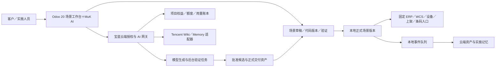

# BlueWMS20 正式开发计划

## 2026-10-16 云端知识与实施基线

以 [云端知识、Tencent 配置与 AI 工作流](../wiki/README.md) 为当前约定：通用示例、AI 使用的说明与 Skill 正文集中云端；本地保留真实合同、当前／正式代码、本次测试及发布执行记录。Git 保留公开工程文档及知识来源，不另在客户 Odoo 建私有知识库。

当前业务用户 Key 对应具体用户／Agent，未来商业项目授权单独建模，不能混为一个“项目总 Key”。当前由 MuK 主持业务工具循环，blue_ai_client 已接入云端代理；云端五类 Task 与共享资料已配置。上架已增加受限 Skill 正文读取、完整合同、新会话 Task 路由及停止本地示例回传；旧运行定义与正式版本保留。直接 Wiki 检索及四个新 AI 入口继续规划，见 [本轮交付](../migrations/putaway-cloud-knowledge-20.md)。后文日期早于本节的交付条目是历史事实。


## 2026-10-12 命名与分类更新

新 20 模块统一采用 `blue_<领域>_<功能>`：库存 `blue_stock_*`、设备 `blue_wcs_*`，条码独立为 `blue_barcode_*`；所有模块直接位于 `bluewms` 下，不建立分类目录。非 `blue_` 的额外 addon 按第三方来源管理，官方 Odoo 基础保持原名。旧 19 名称保留为代码调查和迁移引用，历史 `blueprj_*` 及单功能名称不作为新 20 命名标准。详细目标、来源核查和依赖边界见 [模块分类与命名规划](/Users/jianglang/odoo/bluewms20-doc/bluewms20-module-architecture.md)。

版本：2.3 · 实施基线（云端知识、五类 Task 与本地验证发布）
日期：2026-10-11｜更新：2026-10-16
适用范围：下一版本的新开发与试点交付  
文档状态：方案已根据沟通合并；新增模块与接口尚待实现，排期为估算，阶段出口以实际验收为准。

**后续开发以本文为主计划。** 旧《下一版本开发计划》1.x 和各调查报告保留为参考，不再独立决定开发顺序和产品行为。

## 1. 产品目标与确定的范围

开发基于 **Odoo 20 社区版＋MuK 20＋宝蓝自研 AI 扩展** 的新 WMS 产品。客户本地执行仓库业务，TencentDB Agent Memory 提供云端实施记忆与 Wiki 知识检索，宝蓝云端管理授权、生成、验证任务和交付资产。

本版必须实现：

1. **场景统一配置**：用一次 AI 对话协调 ERP、WCS、设备、上架、条码五类入口。
2. **单点灵活调整**：只修改其中一个入口，保留其他入口的原版本，检查关联影响。
3. **示例生成代码**：从批准的 Wiki 场景和代码示例生成本入口支持的 Python。
4. **数据库保存与本地执行**：代码作为持久化正式版本保存，由固定业务入口执行。
5. **验证后保存启用**：草稿与正式配置分离，不将一条 AI 回复直接当成生效代码。
6. **客户资产持续记录**：同时记录 AI、人工、导入和恢复的配置变化、时间与来源。
7. **准确恢复**：从代码全文、配置快照和同版本交付材料恢复，不从聊天摘要重新推测。
8. **免费基础版＋项目授权**：一把宝蓝 AI API Key 对应一份项目授权，云端服务按权益和额度开放。

客户端默认展示 AI 对话与业务效果，不要求客户逐项勾选定制规则。当前公司、仓库、作业类型、设备和测试样例作为必要上下文；技术人员可以展开代码和验证报告。

首期不纳入：全部旧客户数据库升级、Odoo 16 项目迁移、任意浏览器 JavaScript 动态执行、无限制 Python 执行、由模型实时决定每次设备动作。新增模型／字段、前端组件、第三方库等结构变化通过正式模块交付。

## 2. 平台与数据库基线

### 2.1 官方要求与本项目选择

| 项目 | 官方要求或已核查事实 | 本项目基线 |
|---|---|---|
| Odoo | 20.0 | 社区版 20.0，锁定具体提交／镜像摘要 |
| Python | 最低 3.12 | 3.12，锁定维护版本及依赖；不沿用本机旧 Python 作为服务运行环境 |
| PostgreSQL | **最低 16.0** | 本机当前镜像 `postgres:16.0`；计划维护升级至经验证的 16 系列维护版，并锁定准确版本 |
| Owl | 本次 Odoo 20 随包 3.0.0-alpha.49，含部分兼容层 | 使用 Odoo 自带版本，不另装上游最新包覆盖 |
| MuK | 已有 20.0 分支，当前核查清单为 LGPL-3 | 锁定 MuK 20 提交及完整依赖，不复制本地 MuK 19 整包 |
| 记忆与知识 | TencentDB Agent Memory／Wiki | 由宝蓝云端适配器连接，先验证当前服务能力 |

Odoo 20 官方安装文档明确 PostgreSQL 支持版本为 16.0 或以上；源码 `release.py` 同时声明 `MIN_PG_VERSION = 16`、`MIN_PY_VERSION = (3, 12)`。[官方安装文档源码](https://raw.githubusercontent.com/odoo/documentation/20.0/content/administration/on_premise/source.rst)、[官方版本要求](https://raw.githubusercontent.com/odoo/odoo/20.0/odoo/release.py)

PostgreSQL 16 是本项目减少环境变量的选择，不表示官方只支持 16。选择其他满足最低要求的版本时，应先完成所选版本、驱动和扩展兼容测试，再统一开发、测试与生产环境。

### 2.2 pgvector 是否需要安装

官方文档要求使用 **Odoo 原生 AI 功能** 时安装 pgvector。[官方安装说明](https://raw.githubusercontent.com/odoo/documentation/20.0/content/administration/on_premise/source.rst)

本项目采用 MuK 和 Tencent 云端知识检索，基础路线不默认依赖本地向量索引。只有启用原生 AI／本地检索等实际需要向量扩展的模块时，再增加 pgvector 依赖与安装检查。

Tencent Memory 的存储底座和客户 Odoo 数据库分别管理，不能将 Memory 服务版本或云端存储要求当成 Odoo 的数据库要求。

### 2.3 环境隔离与版本锁定

- 本机独立 Odoo 20 Docker 开发环境已建立；测试与试点仍按用途隔离数据库、配置与数据卷，不修改旧 19 实例。
- 记录 Odoo、MuK、BlueWMS、Python、PostgreSQL、依赖库、镜像及资产构建版本。
- 模块安装清单、启动与备份恢复方法可重建；测试默认使用脱敏数据与模拟设备。
- PostgreSQL 使用专用 Odoo 数据库账号；按环境控制权限和凭据，不将秘密写入示例、Git 或计划文档。

### 2.4 已确认的本地 Docker、目录与 GitHub 基线（2026-10-12）

开发项目安装并运行在本机 Docker 内，宿主机编辑模块文件，通过 bind mount 进入容器。`bluewms` 是新产品的模块源码、第三方模块、开源发布与版本控制目录；本机已有基础环境，后续从该环境继续 S0 兼容验证，不重复创建另一套宿主机 Odoo 服务。

| 项目 | 已确认基线 |
|---|---|
| 模块仓库 | `/Users/jianglang/odoo/bluewms` |
| GitHub 远端／本地分支 | [bluewms/bluewms](https://github.com/bluewms/bluewms)；当前 `main` |
| 模块挂载 | 宿主机 `bluewms` → Odoo 容器 `/mnt/extra-addons`，可读写 |
| Docker 定义 | `bluewms/docker/compose.yaml` |
| Odoo 容器／镜像 | `bluewms20-odoo`／`odoo:20`；读到版本 `20.0-20260926` |
| Python | 容器内 `3.12.3` |
| 数据库容器／镜像 | `bluewms20-db`／`postgres:16.0` |
| 开发访问／数据库名 | `http://localhost:8070`／`bluewms20`；数据库宿主机端口 `5436` |
| Odoo 模块搜索路径 | `/usr/lib/python3/dist-packages/odoo/addons,/mnt/extra-addons` |
| 私有运行配置 | `~/.config/bluewms20/odoo.conf` → `/etc/odoo/odoo.conf`（只读） |
| 持久数据卷 | `bluewms20-odoo-data`、`bluewms20-postgres-data` |
| 镜像及环境锁 | `bluewms/docker/deployment-lock.json`；记录实际镜像摘要，升级后重新核对 |
| 官方源码查阅 | 相邻 `odoo20`，下载分支 `20.0`、提交 `a7950cab13fcb9400d58d582f5583c0f1c0f5405` |

当前 Docker 使用镜像内的 Odoo 官方源码，`odoo20` 未挂载至容器，也未替换镜像中的代码。历史调查提交、下载源码提交和实际镜像版本分别记录；兼容修复及 Owl API 以实际运行版本为准，不能用源码下载成功代表运行版本已更新。

模块与版本管理执行以下约定：

- 后续自研 `blue_<领域>_<功能>`、客户 `blue_project_*`、MuK 及其他第三方模块统一放入 `bluewms`，每个可安装模块直接使用一个子目录，例如 `bluewms/muk_ai/__manifest__.py`；第三方保留原模块名。按本次确认保持模块一级平铺，不建立分类目录，也不把整套上游仓库作为嵌套模块目录。
- 第三方模块纳入同一 Git 仓库追踪，记录上游 URL、许可证、分支、准确提交、依赖和本地补丁。引入源码时不带入上游 `.git` 形成未声明的嵌套仓库；新模块须验证安装／升级和相关业务后才纳入交付版本。
- 宝蓝标准功能通过独立模块继承扩展；通用修复回到标准版，客户差异保留在客户模块，不修改 Odoo／MuK 核心。Python 库与系统依赖由可重建 Docker 镜像管理，不用临时容器安装代替依赖记录。
- Compose、环境说明、依赖及版本锁、模块源码和必要迁移材料进入 Git。记录提交和发布标签以支持重建、对照、升级与回退，第三方原版权和许可随源码保留。
- 开源发布遵守各模块许可和客户资料范围；不将 OEEL 企业核心或未获公开授权的客户资料放入公开仓库。运行配置、密码／Key、数据库、filestore、日志和备份保存在仓库外或被明确排除。
- 挂载使文件变化进入容器；Python 修改后按需重启，模型／视图／数据变化执行模块升级，前端变化核对资源重建和浏览器加载。模块安装、升级和业务测试在 Docker 对应数据库中执行，保留实际结果。

操作说明见 [Docker README](/Users/jianglang/odoo/bluewms/docker/README.md)。2026-10-12 核查时，`bluewms` 中已发现 `.gitignore`、`docker/` 和 `blue_dev_environment/` 为未跟踪内容；后续提交应纳入需要公开的环境材料。本次文档同步没有提交或推送 GitHub，也没有安装新模块。

2026-10-12 首批迁移进展：用户指定的 7 个 MuK Web 模块及 3 个主题必要依赖，已从官方 `20.0` 分支锁定下载至 `bluewms` 并在本地 Docker 开发库安装。独立测试库的 34 项后端／HTTP 测试及前端资源编译通过；HOOT 浏览器交互测试尚未运行，测试退出阶段异常已记录。这仅完成 Web 基础，不代表 MuK AI 或 WMS 业务迁移完成。详情见 [首批迁移记录](/Users/jianglang/odoo/bluewms/docs/third-party/muk-web-migration-2026-10-12.md)。

2026-10-12 AI 基础进展：官方 `muk_ai`、`muk_ai_skills`、`muk_mcp` 20.0 源码已纳入 `bluewms` 并在 Docker 开发库安装，来源与版本锁已记录。独立测试库 309 项后端／HTTP 测试和前端资源编译通过，浏览器交互及真实模型联调仍待验证。本次未填模型 Key 或创建 MCP Key，未接入 Tencent／宝蓝网关；这不代表 S3 的业务闭环已完成。详情见 [AI 安装记录](/Users/jianglang/odoo/bluewms/docs/third-party/muk-ai-install-2026-10-12.md)。

2026-10-12 库存基础进展：原 `blue_stock` 已拆分迁入 `blue_stock_base` 与 `blue_web_theme`，在 Docker 开发库安装。独立库 16 项功能测试、升级、界面卸载／重装和页面检查通过；数量汇总、可用空位、容量维护和公司权限已修正。条码、WCS／ERP、作业锁定及旧客户数据库升级仍待对应阶段完成。详情见 [迁移交付记录](/Users/jianglang/odoo/bluewms/docs/migrations/blue-stock-20.md)。

2026-10-12 库存规则进展：用户确认清单 1、2 独立放在 `blue_stock_rules`，43 项最终联合测试、卸载／重装和运行实例保护检查通过，已备份并安装到开发库。负库存保护及库位冻结／禁止入库已生效；用户随后批准清单 3、4 的可编辑示例闭环，见新增上架策略交付说明。详情见 [库存规则交付](/Users/jianglang/odoo/bluewms/docs/migrations/stock-rules-20.md)。

## 3. 用户操作流程

### 3.1 统一配置场景

```text
打开“场景配置”
  → 确认公司、仓库与作业范围
  → 用对话描述业务需求
  → AI 检索场景模板与批准代码示例
  → 生成场景草稿、相关入口代码及效果说明
  → 显示差异与需要确认的信息
  → 运行样例和关联验证
  → 用户点击“保存并启用”
  → 发布一份完整场景版本
  → 本地业务入口按正式版本执行
```

示例：“A 仓用 ERP 驱动料箱入库，扫描产品和批次，按存储类别分配库位，确认后发送设备任务，设备完成后反馈 ERP。”

场景只启用实际需要的入口。人工仓库可以不配置设备和 WCS 定制，不为凑齐五个入口生成无用代码。

### 3.2 单点调整

在场景中点击某个入口的“AI 调整此项”，会话固定关联当前场景、对象范围、入口及基础版本。

单点修改形成新场景版本，未修改的入口继续引用原代码版本。例如场景 V3 的条码代码为 B2；只修改条码后形成场景 V4、条码 B3，其他四处代码不重新生成。

若修改需要联动其他入口，先展示影响和原因，再由用户决定本次变更范围。不能暗中将单点调整变成全场景重写。

### 3.3 恢复操作

- **恢复场景默认**：撤销该单点覆盖，生成一个新正式版本。
- **恢复历史场景**：恢复指定历史版本的整套配置与代码引用。
- **恢复失败部署**：重新应用最后成功版本或执行交付包规定的恢复流程。

以上操作保留历史，不修改已经发布的版本正文。配置恢复不撤销已经发生的库存移动或设备动作。

### 3.4 首批场景

| 场景 | 主要入口 | 首期用途 |
|---|---|---|
| 人工扫码入库 | ERP 映射、条码、上架 | 首个完整试点，不依赖真实设备 |
| ERP 驱动自动入库 | ERP、WCS、设备、上架、条码 | WCS 基础可靠性通过后试点 |
| 拣选出库 | 出库映射、任务条件、设备、条码 | 验证全拣／部分拣差异 |
| 库内移库 | 单据映射、条码、目标库位、必要设备 | 验证源／目标库位关联 |
| 盘点与差异处理 | 盘点、条码、必要设备 | 按现有盘点流程逐步扩展 |

## 4. 总体架构与职责



| 层次 | 权威职责 |
|---|---|
| 本地 Odoo | 业务权限、真实配置、场景应用结果、库存与设备任务状态 |
| MuK | 对话、流式显示、追问、受控工具调用与会话事件 |
| 宝蓝场景服务 | 配置解析、代码草稿、验证、冻结、发布、启用与恢复 |
| 宝蓝网关 | 客户身份、授权、额度、生成任务、云端资产与费用 |
| Tencent | 记忆和知识检索；不充当准确配置／代码全文的唯一备份 |
| 模型服务 | 根据输入生成候选；不自行批准候选或接管日常 WMS |

云端调用发生在实施和变更时。日常扫码、上架、库存验证和设备任务推进使用本地已发布成果；断网不要求重新调用模型。

## 5. 客户身份、授权与开源边界

### 5.1 永久身份与 Key

使用永久 `tenant_id`、`installation_id` 和公司／对象稳定标识。Key 是可轮换凭据，换 Key 不换项目身份，不丢历史资产。

一份授权对应一个客户项目和合同约定的生产部署、公司、仓库／设备范围；测试环境登记为子环境。一次调用或单点修改不自动变成第二份项目授权。

### 5.2 凭据分开管理

| 凭据 | 保存／使用范围 |
|---|---|
| 宝蓝客户 AI Key | 客户本地服务端请求宝蓝；云端保存校验摘要 |
| 模型厂商 Key | 宝蓝云端专用凭据存储，不下发客户 |
| Tencent 服务 Key | 云端 Memory／Wiki 适配器，不公开管理密钥 |
| Odoo／MuK MCP Key | 本地工具身份和权限；不代表商业授权 |
| ERP／设备凭据 | 标准连接服务保存，配置包只保存引用 |

客户端请求不能自行指定其他客户的租户、Memory Agent 或资产归属。API Key 不进入提示词、Wiki、代码、运行日志或交付快照。

### 5.3 默认产品行为

| 状态 | 业务与已交付成果 | 新生成／新发布 |
|---|---|---|
| 新部署未授权 | 免费基础 WMS，必要基础设置可用 | 宝蓝定制服务未开通 |
| 有效授权 | 正常本地运行 | 按项目权益和额度使用 |
| 临时断网／云服务故障 | 已启用代码继续运行，事件本地排队 | 暂停需要云端知识／模型的生成；本地草稿查看、保存、验证与人工发布按本地权限处理 |
| 服务到期 | 已交付本地成果按约定继续运行 | 暂停新云端定制／升级，高级管理进入只读 |
| Key 吊销 | 不直接停止库存或在途设备任务 | 拒绝该 Key；重新签发后恢复云端访问 |

已交付资产允许本地导出及按原签名／版本恢复。年费金额、云端资产下载期、保留期和响应等级在正式收费前确定；本版不把未确定的商业数字硬编码。

### 5.4 开源与收费

宝蓝自研且版权／依赖来源明确的本地 AI 模块可以开源。项目收费集中在云端知识、生成、验证、兼容升级、托管和支持；本地管理员能够修改开源客户端，真正可强制执行的商业边界在云端服务。

Odoo 企业 OEEL 源码不因依赖腾讯知识库而自动获得公开分发权。主路线参考企业设计并独立实现；有企业订阅的客户可另用符合许可的桥接模块。[官方企业许可](https://raw.githubusercontent.com/odoo/documentation/20.0/content/legal/licenses/enterprise_license.txt)

MuK 和现有 LGPL／AGPL 模块保留各自许可与版权，先完成来源清单，再确定新模块许可证。原生 Odoo AI 的 IAP 费用与宝蓝自己的云端费用分开核查，不默认接入原生 IAP。

## 6. 场景配置的统一模型

### 6.1 四层关系

```text
批准的场景模板
  → 客户场景基础配置
  → 明确范围的单点覆盖
  → 验证、冻结后的正式场景版本
```

模板更新不自动改变客户系统。每份正式版本保存解析后的准确结果、五类代码引用和必要代码全文，运行时不猜测合并，也不按最后编辑时间决定覆盖顺序。

首期每个公司／仓库／作业类型采用明确场景绑定；相同范围和入口的冲突覆盖拒绝发布。扩大范围或改变优先级必须形成可见差异和新的验证。

### 6.2 统一管理与真实存储

统一场景服务维护定义、作用域、代码和版本；实际配置通过适配器写到 Odoo 对应位置，例如公司、作业类型、设备记录、上架规则或数据库参数。

`res.config.settings` 只作为界面入口，不是长期资产存储位置。数据库全局参数不能伪装成每个仓库独立设置；改变全局参数时必须列出受影响场景。

配置定义包含：技术键、业务说明、值类型、允许值／限制、默认值、作用域、持久化适配器、相关约束与模块版本。Selection 保存技术值；Boolean 的 `false`、数字 `0`、清空与“本次不修改”分别表达。

新增 Selection 值或模型字段属于结构变更，进入模块与迁移流程，不能直接写一个未定义字符串。

### 6.3 最小持久化对象

| 对象 | 职责 |
|---|---|
| `blue.config.profile` | 客户场景、范围、模板引用与唯一正式版本指针 |
| `blue.scene.template` | 场景模板定义和精确批准版本引用 |
| `blue.scene.override` | 某入口／明确对象的单点覆盖 |
| `blue.customization` | 场景下的五类定制设置与需求说明 |
| `blue.customization.version` | 不可变代码正文、协议、模板引用与验证材料 |
| `blue.config.change` | 场景／单点变更草稿及基础版本 |
| `blue.config.release` | 完整场景快照、五类引用、签名与验证摘要 |
| `blue.config.application` | 某部署实际应用哪版、时间、结果及错误 |
| `blue.config.event/outbox` | 已提交变更事件与待同步队列 |
| 云端授权／模板／用量表 | 项目权益、准确模板资产、任务和计费账本 |

逻辑对象可以按 MVP 合并界面，不要求每个对象独立成一个模块。`blue.customization` 显示的生效版本由场景正式版本解析，不能有另一条绕过场景发布的独立启用路径。

## 7. 五类入口与执行合同

以下 `hook_code` 和方法名是拟开发协议，先在基础模块中固定并测试，再用于 Wiki 示例和客户代码。每个合同声明输入、输出、允许辅助方法、错误、兼容版本与标准回退规则。

| 入口 | 当前参考位置 | 提供给脚本的输入 | 返回结果 | 标准模块的职责 |
|---|---|---|---|---|
| ERP · `erp_mapping` | `product_sync()`、`picking_create()` | 已鉴权报文、允许字段、单位／编码映射 | 产品／单据字段值或明确错误 | 公司权限、ORM 写入、事务、幂等与响应 |
| WCS · `wcs_creation` | `action_create_wcs_request()` | 当前单据明细摘要、可用设备、场景 | 创建条件、任务参数和设备选择 | 明细归属、任务创建、并发保护与发送队列 |
| 设备 · `device_protocol` | `button_execute()` 与设备回调 | 标准任务／回执、非秘密协议信息 | 设备报文或规范化回调结果 | 通信、凭据、超时、去重和任务状态 |
| 上架 · `putaway_policy` | `_get_putaway_strategy()`、`_check_can_be_used()` | 已通过标准准入的候选与库存摘要 | 候选过滤／排序结果 | 容量、锁定、批次、预留与最终分配 |
| 条码 · `barcode_policy` | `_get_barcode_config()`、标准扫描处理器 | 作业类型、场景、前端支持能力 | 扫描策略、步骤或后端验证结果 | 固定前端执行与后端最终校验 |

### 7.1 ERP

拆分控制器的鉴权、校验、映射、业务写入和响应；客户代码只影响允许的映射与准备结果。不得依据 AI 猜测未知单位的换算率。

重复外部单号／请求号采用明确幂等规则，跨公司编码分别映射。失败报文的整单／部分成功行为写入接口合同。

### 7.2 WCS

按场景选择设备，禁止全库 `search([], limit=1)` 作为客户设备选择。检查传入明细确属当前单据及公司。

用稳定任务号、唯一性约束和并发控制阻止重复创建。代码返回任务候选，实际发送由持久 worker 执行。

### 7.3 设备

按稳定 `adapter_code` 注册厂商实现；设备名称改动不改变分派。通用通信放标准模块，客户差异表达为报文／回执脚本。

协议需要新增连接库、硬件能力或系统依赖时交由正式模块实现，不让客户脚本直接发网络请求。

### 7.4 上架

标准逻辑先排除锁定、不准入、容量不足等候选，再调用脚本过滤和排序，最终分配前重新验证并发占用。

首期采用确定性业务规则，不让模型在每次入库时实时选择库位。输出带可阅读的选择／拒绝原因。

### 7.5 条码

代码返回当前前端已支持的扫描策略。现有 Boolean／Selection 可作为底层值，客户用对话配置；前端不执行数据库里的任意客户 JavaScript。

新增扫描步骤或前端交互先开发标准处理器并更新能力目录，再允许 AI 生成使用该能力的代码。

### 7.6 跨入口验证

必须检查：目标库位与设备可达范围、条码确认与任务触发条件、ERP 单位数量与库存／设备任务一致性、设备回执与库存验证／ERP 回传顺序。

没有客户定制时使用已验证标准流程；已启用客户脚本失败时阻止受影响操作并报告版本，不能静默换回默认规则继续发送任务或分配库存。

## 8. 数据库代码的生成、验证与启用

### 8.1 受限制的执行环境

脚本作为持久 Text 正文保存，使用当前 Odoo 20 支持的执行机制，提供 `input_data`、`result` 和明确白名单的纯辅助方法。默认不提供 `env`、`sudo()`、游标、网络客户端或文件操作。

仅接受批准的有限语法与数据操作；拒绝任意 import、系统命令、直接 SQL、类／函数动态定义、递归和无界循环。若支持遍历，必须限制输入、迭代规模与输出大小；不允许通过自定义对象逃逸到完整运行环境。

当前上架已使用独立 AST 白名单解释器，不调用 eval、exec 或 safe_eval。不能把 safe_eval 当作完整进程隔离或可靠硬超时；其他合同也必须明确执行能力和限额。复杂计算转向有资源限制的 worker 或正式模块，不能在库存事务里无限执行。

以下仅是 ERP 映射需求的意图示例，不是当前上架解释器的可执行代码；包括 strip() 在内的调用须由未来 ERP 合同明确支持后才能使用：

```python
# input_data 由标准服务准备，下面只是 ERP 字段转换示例。
product = input_data["product"]
result = {
    "default_code": product["code"],
    "name": product["name"].strip(),
}
```

服务器仍检查字段白名单、结果 schema、必须值和目标公司。合法 Python 或合法 JSON 不等于业务已经通过验证。

### 8.2 生成前需要的材料

- 当前场景、正式版本、单点范围与用户原始需求。
- Odoo 20 实际模型字段、可写性、类型、Selection 技术值、模块与 hook 版本。
- 本入口批准模板的精确代码正文、版本、摘要与测试样例。
- 允许辅助方法与前端支持能力。
- 客户已有约束、已批准实施结论，以及需要澄清的信息。

AI 输出结构化候选：代码、解释、修改范围、模板引用、测试样例、依赖和待确认项；通过专用工具提交，不从自由文本 Markdown 中猜执行内容。

### 8.3 发布状态

```text
草稿 draft
  → 验证中 validating
  → 已验证 validated
  → 用户批准 approved
  → 正式制品 released
  → 目标部署已应用 applied
```

失败、拒绝和取消保留记录。`released` 与 `applied` 分开；最后成功应用的版本才是默认恢复目标，不能取最大版本号的草稿。

“保存草稿”不影响生产行为。“保存并启用”由有权限用户发起，在服务端检查授权、冻结内容、基础版本和实际验证结果。简单变更可以在同一弹窗中完成，不要求另设一个重复操作流程。

正式内容不可编辑；改变正文或实质参数使原验证／批准失效。恢复创建新版本并引用原版。

### 8.4 一次启用的顺序

1. 校验项目授权、用户权限、目标范围、模板状态和兼容性。
2. 冻结候选摘要，校验代码／输出和样例／关联业务结果。
3. 展示准确差异、影响及验证限制，用户批准这一份确切内容。
4. 取得正式制品／签名，检查基础版本未发生变化。
5. 在本地事务中写入纳管配置、应用记录和事件，切换场景正式版本指针。
6. 提交后异步同步云端，更新客户端正式版本展示。

同一基础版本的并发修改采用锁和版本检查，不静默覆盖。模块升级或会产生外部动作的配置，不伪装成一个可全部事务回滚的普通字段写入。

AI 生成与云端知识读取需要联网；本地已取得的草稿／正式代码按本地权限完成验证、人工发布或恢复，不因知识服务临时故障要求重新请求模型。未来若增加商业授权检查，必须单独说明，不把未实现的网关当作当前发布前置条件。纯数据库脚本变更通常不需重启，首次部署执行器、结构变化和资源更新按模块发布处理。

## 9. Tencent Wiki、记忆与准确资产

### 9.1 模板的正式结构

| 字段 | 含义 |
|---|---|
| `template_id/version` | 永久模板编号和不可变批准版本 |
| `scenario_type/hook_code` | 场景类型及适用入口 |
| `odoo_series/module_versions` | 固定到 20.0 与支持的模块范围 |
| `contract_version` | 输入／输出和辅助方法合同 |
| `code/hash` | 精确代码原文及内容摘要 |
| `examples/tests` | 输入、预期结果、业务边界和验证记录 |
| `status/scope/source` | 批准状态、公共／客户范围和来源 |

通用示例、说明及 Skill 正文的批准版本集中在云端 Wiki／Skill 或其准确资源中；Git 保留来源和公开工程说明，本地不另维护通用示例库。本地只保存当前策略及其测试、正式代码和恢复材料。当前模板仍耦合运行定义和示例，须先解耦及验证桥接再停止示例回传。自动摘要、旧例或未经验证的代码不能直接成为批准示例；19 示例先适配并验证到 20。

### 9.2 查询和生成顺序

按已鉴权客户和固定场景筛选→匹配 Odoo／模块／hook 版本→语义检索示例→按精确版本读取原文→生成候选→保存来源及验证结果。

客户私有资产、宝蓝公共模板、个人会话分别授权。公共复用只接受已脱敏和审核的模板。检索内容作为资料，不能改变系统权限或批准条件。

### 9.3 记忆隔离与服务验证

服务端从有效用户凭据及授权绑定解析已有 Team／Agent／Task 标识，不接受模型或客户端伪造。当前一个 odooAI 项目团队，用户各自 Agent 和私有记忆，五类入口用 Task 分类。Task 不是隐私隔离边界，L2／L3 按 team + agent 隔离；不同客户使用独立团队、ACL、实例或等价边界。

接入阶段必须验证：两个客户的越权拒绝、同名资料隔离、记忆修正、模板版本、Key 吊销、导出／重建、超时和实际费用。云托管和开源 Hub／Proxy 分别核查，不假定接口和能力完全相同。

### 9.4 记忆写入与账单

目标流程在发布成功后记录实施结论、原因和正式版本引用；自动抽取先列候选，验证／审阅后才批准共享。当前采用提炼提示、私有默认和人工批准，端到端自动候选审批尚未实现。原始聊天、测试和推测不能直接升级为团队事实；秘密值不进入记忆。

独立计费账本属于后续目标：记录请求编号、项目、模型、实际输入／输出与缓存用量、Memory Credit、成本表版本及重试原因。当前不能把 MuK 本地参考价格或尚未实现的账本当作真实扣费结果。

## 10. 前端与 MuK 20

### 10.1 组件范围

- 场景工作台：范围、正式版本、场景说明和五处摘要。
- 定制点卡片：继承／覆盖状态、代码版本、验证与 AI 调整入口。
- AI 对话弹窗：需求、追问、流式内容、模板来源、草稿与操作。
- 差异／验证面板：变更项、关联影响、样例结果和待解决问题。
- 发布／恢复面板：准确版本、应用状态、历史和恢复范围。

共用有作用范围的场景编辑上下文，正式状态、草稿、单点覆盖和异步任务分开。signal／proxy 管理状态，computed 汇总界面信息，插件组织共享功能，useProps 声明组件接口。

前端汇总不能替代后端验证。扩展预览失败可显示局部错误，保留父级／服务端草稿；不能将失败吞掉后显示验证成功。

### 10.2 异步和扫码

所有响应关联场景、任务、会话与请求编号。切换场景或关闭弹窗不允许旧结果回填另一个目标；清理显示订阅、键盘／设备监听，明确取消和重试语义。

验证条码焦点、快速扫描、重复事件、装箱、批次和 WCS 按钮；AI 流式输出不应触发无关区域频繁更新。性能通过实测确认。

### 10.3 MuK 复用与专用工具

复用聊天窗口、会话、流式、追问、工具分派和事件日志。五类入口固定会话目标，不能仅依赖随页面变化的 `view_context`。

下列是待扩展的工具规划，不是全部已实现接口。当前已实现 blue_read_code_asset、blue_submit_code_draft、blue_validate_code_draft 和 ask_user；完整合同及云端只读检索／读取仍需开发。拟议工具：

- `blue_read_scene/blue_read_hook_contract`：读取授权范围内的配置与能力。
- `blue_search_templates/blue_read_template_version`：检索并取得批准示例。
- `blue_propose_scene/blue_propose_point_override`：创建明确范围草稿。
- `blue_save_hook_candidate`：保存结构化代码候选。
- `blue_validate_candidate/blue_preview_change`：验证和显示准确影响。
- `blue_request_publication/blue_export_release`：提交发布申请或导出资产。

发布由专用服务端方法控制，AI 不批准自身候选。Agent 使用明确工具白名单，不开放任意模型写入、库存过账、设备发送或生成通用 MCP 执行代码。

### 10.4 迁移规则

采用 MuK 20，评估需要的 Skills／Access／Automation 扩展后逐个增加。宝蓝 provider 在独立模块注册，模型协议、流式、工具调用、取消、错误和用量均需测试。

现有条码 Owl 2 组件逐个适配，重点是 static props、状态、模板、引用、effect 和事件生命周期。Odoo 20 保留部分服务／env 兼容接口，依据实际 API 迁移，不做机械全局替换。

## 11. 模块划分与依赖

新 20 按 [模块分类与命名规划](/Users/jianglang/odoo/bluewms20-doc/bluewms20-module-architecture.md) 采用领域前缀：`blue_stock_*`、`blue_wcs_*`、独立 `blue_barcode_*` 等；客户模块建议采用 `blue_project_<项目>_<功能>`。旧 19 名称只用于来源调查与迁移对应。后续模块清单为拟开发名称，改名须同步依赖、资源和数据迁移，不直接批量改现有目录。

| 模块 | 必要依赖 | 职责 |
|---|---|---|
| `blue_extension_contract` | `base/stock` | 合同、能力目录、纯数据脚本执行器与结果校验；不依赖 AI 模块 |
| `blue_config_asset` | 合同模块、`stock`（首期） | 场景、覆盖、代码／配置版本、解析、发布、事件与恢复 |
| `blue_stock_putaway` | 资产模块、`blue_stock_rules` | 上架输入、运行约束、真实单据试算、容量分配与审计；通用示例目标由云端管理，旧模板待解耦 |
| `blue_barcode_extension` | 资产模块、迁移后的 `blue_barcode_base` | 条码输入、后端策略调用、标准前端能力 |
| `blue_wcs_extension` | 资产模块、迁移后的 `blue_wcs_base` | WCS 场景接入、设备注册、发送和回执联动 |
| `blue_erp_extension` | 资产模块、拟议 `blue_erp_base` | ERP 映射脚本与场景接入；不强制依赖 WCS |
| `blue_ai_client` | 资产模块、MuK AI／MCP | 场景 AI UI、会话绑定、provider、授权、固定工具及 Tencent 知识／记忆 API 适配 |
| `blue_delivery_asset` | 资产模块 | 签名制品、兼容检查、导出／应用／恢复包 |
| 云端 Wiki／Skill | 由 `blue_ai_client` 受限读取 | 统一批准示例、说明和流程；不另建本地 `blue_ai_skills` 知识模块 |
| `blue_project_*` | 相关标准模块 | 超出脚本能力的客户结构／前端／协议扩展 |

合同模块不查询资产模块才能运行；业务桥接依赖资产模块后完成具体调用，避免循环依赖。免费基础业务不强依赖 AI 模块或云端 Key。

MuK 的 `muk_mcp`、`muk_web_utils` 等实际依赖按锁定版本完整安装；防止 addons 路径中同名模块互相覆盖。云端首期一个服务内划分授权、生成、知识、资产与用量职责，耗时任务后台执行，不提前拆大量微服务。

## 12. 发布资产与接口合同

### 12.1 场景正式包示例

以下是拟议结构，示例编号不是实际数据库记录：

```json
{
  "release_id": "rel-example-004",
  "tenant_id": "tenant-example",
  "installation_id": "install-example",
  "profile_ref": "scene:warehouse-a:incoming",
  "odoo_series": "20.0",
  "base_release_id": "rel-example-003",
  "template_ref": {"id": "manual-inbound", "version": "1"},
  "hook_versions": {
    "erp_mapping": "code-erp-002",
    "wcs_creation": null,
    "device_protocol": null,
    "putaway_policy": "code-putaway-002",
    "barcode_policy": "code-barcode-003"
  },
  "point_overrides": [
    {"hook_code": "barcode_policy", "target_ref": "picking-type:incoming-a"}
  ],
  "validation_status": "passed",
  "content_hash": "sha256-of-canonical-content"
}
```

正式包还包括准确参数、代码全文、稳定对象引用、模块与协议版本、批准与测试摘要和签名。`null` 表示该入口没有客户脚本，使用已验证标准流程。

### 12.2 网关接口草案

| 接口 | 用途 |
|---|---|
| `POST /v1/installations/activate` | 关联 Key、授权、部署和环境 |
| `GET /v1/entitlements` | 查询权益与额度 |
| `POST /v1/ai/jobs`、`GET /v1/ai/jobs/{id}` | 创建生成／验证任务与取得状态 |
| `POST /v1/knowledge/search` | 在固定租户范围检索批准资料 |
| `GET /v1/templates/{id}/versions/{version}` | 取得精确模板正文 |
| `POST /v1/config/releases` | 生成冻结的正式资产与签名 |
| `POST /v1/config/applications` | 上报部署应用结果 |
| `POST /v1/events/batch` | 幂等同步配置事件 |
| `GET /v1/assets/{id}/download` | 下载有权访问的交付包 |
| `GET /v1/usage` | 查询项目用量与费用 |

这是宝蓝拟开发接口，不是 Tencent 的现成 API。统一追踪编号、部署身份、能力版本、错误结构和幂等键；相同幂等键但不同内容拒绝。

云端身份、Odoo 用户权限、专用工具范围和冻结发布批准分别检查。调用成功、结构正确、样例通过和实际应用成功分别展示，不能合并成一个含糊的“成功”。

## 13. WCS 可靠性与配置事件

### 13.1 任务发送

现有数据库保存点不能撤回设备已经收到的命令。新流程先持久保存任务和发送记录，提交后由 worker 处理：

```text
pending_send → sending → accepted → running → completed
                  ↓          ↓
               unknown     failed / cancelled
```

- 每个命令有稳定外部任务号，重试沿用原号；保存请求和回执摘要。
- 设备已接受但响应丢失时进入 `unknown`，先查询／核对，不能盲目重发。
- 设备不支持去重或查询时，提供可见的人工核对，不能宣称端到端 exactly-once。
- 回调验证设备身份，重复只处理一次，乱序不倒退完成状态。
- 取消是独立命令，必须区分本地请求取消与设备确认取消。
- 在途任务固定场景和代码版本，后续配置发布不更改其处理规则。
- Key、年费、模型或 Memory 状态不参与在途设备任务推进。

### 13.2 变更记录和同步

对五类纳管配置及场景版本记录 `create/write/unlink` 或专用服务操作。事件包含永久编号、准确旧／新值、时间、用户、原因、来源和版本。

本地修改与 outbox 同事务保存，提交后才同步云端；失败事务不能产生“已应用”事件。重复投递不重复建立版本或计费。

人工直接改纳管设置也要记录。旧旁路、迁移或直接 SQL 通过定期快照比对发现漂移，先核实再纳入版本，不让云端无提示覆盖现场变化。

## 14. 交付包、备份与恢复

### 14.1 正式场景资产包

```text
release-manifest.json      客户、部署、场景、版本、摘要、签名与依赖
scene-snapshot.json        解析后的准确参数、作用范围与对象引用
point-overrides.json       单点覆盖、基础版本与范围
scripts/                   五类代码全文、协议与模板引用
rules/                     必要的结构化映射和 schema
addons/                    需要的客户模块制品
migrations/                模块或配置结构迁移与限制
validation-report.md       实际验证与验收结果
restore-guide.md           恢复顺序、核对和回退条件
secret-references.json     凭据引用，不含秘密正文
```

对象存储、Git、数据库和附件正文分别备份。签名和内容摘要用于完整性检查；数据库 readonly 字段不能独自实现防篡改。

### 14.2 配置恢复与整库恢复

配置恢复包含场景、单点覆盖、代码和必要主数据引用；整库恢复还包含库存、预留、批次、单据、filestore、运行环境和设备在途状态。

数字数据库 ID 不跨环境复用。标准记录优先 XML ID，客户记录使用永久 UUID 与有作用域的业务键；映射歧义停止处理，不猜名称。

恢复顺序：

1. 确定目标部署、恢复类型、最后成功应用版本和设备现场状态。
2. 准备兼容的 Odoo／MuK／BlueWMS／客户模块和环境。
3. 整库恢复时还原一致的数据库与 filestore；新库配置恢复时先建立公司、仓库和必要主数据。
4. 建立稳定引用映射，按依赖恢复配置、场景、覆盖与脚本。
5. 绑定秘密凭据，检查实际持久化值和版本摘要。
6. 运行关键条码、上架、数量／单位／批次／库位与任务状态检查。
7. 核对设备任务，恢复过程中默认不发送真实命令。
8. 确认后开放作业，保存新应用记录和恢复事件。

配置回滚不撤销已完成库存移动，代码回退不一定能逆转数据库迁移。每次结构升级声明可逆、整库回退或向前修复条件。

### 14.3 服务目标

试点目标：本地配置与事件同事务提交；正常网络下事件同步延迟争取不超过 1 分钟；兼容环境准备完成后，场景资产包在 1 小时内完成导入与验证。

整库灾备的 RPO 15 分钟／RTO 4 小时可作为报价和演练目标，必须按规模、网络、备份和设备核对实测后才能成为承诺。断网期间异步云端不会保证已有最新现场配置。

## 15. 分阶段开发顺序与验收出口

建议配置：一名 Odoo／WMS 工程师、一名云端／集成工程师，前端与测试各约半个全时投入，实施人员提供样例和验收。按此配置以 **14 周**为初步目标；人数、迁移缺陷或试点复杂度变化时依据实际完成情况重排。

第一阶段只承诺验证最小模块集合，不把整个现有 32 模块及所有客户项目视为两周可迁移。阶段验收不过，先处理阻碍，再扩大功能。

| 阶段 | 参考周期 | 必须完成 | 验收出口 |
|---|---|---|---|
| S0 环境与兼容 | 第 1–2 周 | 独立 Odoo／PG／MuK 20；最小 BlueWMS 集合；单位、批次、配置 API 与 Owl 适配 | 入／出／移库、上架、包装／批次、条码和模拟设备流程可运行；版本清单可重建 |
| S1 合同与测试样例 | 第 3 周 | 五类输入／输出、允许辅助方法、模板结构、作用域、发布合同和设备模拟案例 | 固定协议与首场景样例评审；拒绝边界有测试依据 |
| S2 场景与代码基础 | 第 4–5 周 | 持久模型、受限执行器、模板／覆盖解析、差异、关联验证、事件、发布和恢复 | 无 AI 也能保存一份场景、单点修改、启用及恢复；其他入口保持原版 |
| S3 AI／Tencent／授权 MVP | 第 6–8 周 | MuK 场景 UI、固定工具、网关、Key／额度、Wiki 精确示例、记忆、代码生成 | 人工扫码入库场景完整闭环；租户隔离、断网运行、账单与恢复演示通过 |
| S4 五类与设备闭环 | 第 9–11 周 | ERP／WCS／设备／上架完整桥接；持久发送／回执核对；复杂需求模块通路 | 五类样例与关联流程通过，重复／超时／乱序可追踪且不重复执行 |
| S5 客户试点与发布 | 第 12–14 周 | 一至两个客户、多公司、恢复演练、实际成本、运维与交付资料 | 验收签字；阻断问题清零；资产、费用、支持与恢复边界明确 |

### 15.1 MVP 必须达到的结果

- 无 Key 的全新部署能运行基础 WMS；有效 Key 开通对应项目服务。
- 一次对话配置“人工扫码入库”，返回有来源版本的场景和代码草稿。
- 只修改“批次扫描要求”等一个点，其他入口代码保持原值。
- 草稿不运行，验证后保存启用，实际扫描行为变化。
- 断网后继续使用正式代码，重新联网后事件可同步。
- 新测试数据库使用不同数字 ID，仍能恢复正确场景与原代码。
- 非法代码、版本冲突、未知前端能力、跨客户资料访问被拒绝。
- 能追踪一个成功定制的用量、费用、人工审核与测试结果。

MVP 的设备定制只进入模拟与候选，不在 WCS 可靠性通过前让新 AI 发布流程驱动真实设备。

### 15.2 可直接安排的工作包

| 编号 | 工作包 | 主要交付物 |
|---|---|---|
| BW20-01 | 建立 20 环境与版本锁 | 环境说明、依赖清单、重建与备份方法 |
| BW20-02 | 最小模块迁移 | 字段／模块／XML ID／配置 API 修复与回归记录 |
| BW20-03 | 条码 Owl 3 适配 | 可加载与可操作的最小条码流程、焦点／事件验证 |
| BW20-04 | 客户身份和场景作用域 | 永久编号、绑定规则、权限与冲突案例 |
| BW20-05 | 五类合同和能力目录 | schema、辅助方法、版本、拒绝规则与样例 |
| BW20-06 | 脚本执行器 | 静态／运行边界、结果校验、错误和规模控制 |
| BW20-07 | 场景／覆盖／正式版本 | 模型、解析、唯一生效指针、差异和并发保护 |
| BW20-08 | 发布与事件队列 | 冻结批准、应用状态、人工记录与幂等同步 |
| BW20-09 | 配置资产恢复 | 完整包、稳定引用导入、单点／整体恢复演示 |
| BW20-10 | MuK 场景 UI 与工具 | 工作台、绑定会话、代码草稿和验证操作 |
| BW20-11 | 宝蓝网关与授权 | 激活、轮换、吊销、权益、额度与用量账本 |
| BW20-12 | Tencent 接入验证 | 两客户隔离、修正、版本、导出、超时和费用记录 |
| BW20-13 | 模板生成闭环 | 精确示例→候选代码→样例验证→保存启用 |
| BW20-14 | ERP／上架桥接 | 业务映射、候选排序、数量单位与并发检查 |
| BW20-15 | WCS／设备可靠性 | 持久发送、任务号、unknown、回调／取消核对 |
| BW20-16 | 客户模块通路 | 一个结构变更候选的 Git、安装／升级测试与恢复材料 |
| BW20-17 | 试点验收与运维 | 多公司／断网／恢复报告、成本及交付包 |

BW20-01～03 先完成；BW20-05～09 构成不依赖 AI 的资产基础。云端与 Tencent 工作可以在基础开发期间并行，但以验证后的接口接入。每次交付按工作包说明实际改动、验证及剩余问题。

## 16. 测试与交付验收

| 类别 | 必测场景 | 合格结果 |
|---|---|---|
| 基础业务 | 入／出／移库、单位、预留、批次、包裹、上架 | 数量、位置和状态正确，原流程不被定制破坏 |
| 类型与选项 | `false`、`0`、清空、未定义 Selection／返回键 | 准确持久化或明确拒绝，不默默省略 |
| 场景 | 多入口统一、单点修改、移除覆盖、模板升级 | 完整版本一致，未改入口不重写，冲突可解释 |
| 代码 | import、SQL、网络、递归、无界／过大遍历、坏结果 | 启用前拒绝，运行错误可定位，原正式版保留 |
| 权限 | 多客户、多公司、同名对象、伪造 ID／Agent | 越权拒绝，Key 不授予本地管理员权利 |
| 并发 | 两人同版修改、重复发布和重投事件 | 无静默覆盖、重复版本或不明重复收费 |
| 前端 | 切换场景、关闭／重开弹窗、晚到响应、重复点击 | 不错误回填，草稿与焦点正常，无残留监听 |
| ERP | 重复单号、坏报文、未知单位、整单失败 | 不重复创建、不推测单位，失败边界一致 |
| WCS | 并发创建、已接受但超时、重复／乱序／伪造回调 | 不重复实际任务、不倒退状态，unknown 可核对 |
| 断网 | 网关、Tencent、模型不可达 | 正式本地作业继续，新云端操作明确暂停 |
| 恢复 | 新 ID 环境、恢复单点／整场景、整库与在途设备 | 代码和参数准确，设备不重复发送，限制有记录 |
| 模块交付 | 新装、升级、迁移、前端资源重建 | 依赖和关键业务回归通过，回退条件明确 |
| 用量 | 缓存、失败、重试、Memory 和生成 | 可对账，可计算单次成功定制总成本 |

测试使用锁定的 20 数据库、脱敏样例和设备模拟服务；复用有价值的原测试，补足场景、并发、外部副作用与恢复测试。不将语法、schema 或 mock 成功写成完整业务已验证。

试点目标：纳管正式变更及代码正文记录完整；恢复样例全部通过；越权案例全部拒绝；日常 WMS 不依赖模型调用。标准配置实施时间和首次草稿通过率先建立人工基线，再评估改善，不预设未经验证的性能百分比。

## 17. 开发规则与实施交付物

### 17.1 代码规则

- 先阅读并复用现有实现；标准／客户功能分离，继承优先，保留父流程和返回。
- 不修改官方 Odoo 或 MuK 核心，不复制整套标准模块作为客户版本。
- 模块依赖、模型／视图／权限／资产与迁移共同进入发布。
- 标准修复回到标准版，客户结构差异放 `blue_project_*`。
- 每次变更验证相关数量、单位、批次、库位、预留和任务流程；没验证的如实写明。
- 场景、代码合同、模板和运行环境均版本化；升级先做兼容检查，不默默改变旧代码含义。

现有开发规则作为原工程规范参考。新 20 工程建立自己的清晰入口说明，五类合同稳定后再更新公司共享规则，不能让多个项目独立修改规则副本。

### 17.2 每阶段交付物

- 可重建的代码、环境和锁定版本。
- 功能说明、接口／schema、准确作用范围及样例。
- 实际测试报告、已知限制与阻碍。
- 数据／代码迁移及恢复材料。
- Wiki 批准模板与代码资产的精确来源。
- 正式交付包、应用记录和费用／支持边界。

文档和模板以最终实现更新，不保留已经弃用的接口作为现行实施要求。

## 18. 开发启动与尚待确认的参数

### 18.1 按计划立即启动的顺序

1. 使用已确认的 `bluewms` 仓库和本机 Docker 开发环境，核对镜像／Python／PostgreSQL 版本锁；引入 MuK 20 与依赖并完成安装验证。
2. 形成最小模块安装清单和许可／代码来源清单，修正已知兼容问题。
3. 通过基础业务、条码与模拟 WCS 的验证。
4. 冻结“人工扫码入库”的合同、一个批准代码示例和输入／预期结果。
5. 先完成无 AI 的场景草稿→单点调整→验证→发布→恢复。
6. 接入 MuK、Tencent 与授权网关，完成真实对话生成闭环。
7. 按阶段扩展，其余入口及真实设备遵守验收出口。

### 18.2 在对应阶段确定，不阻断前期基础开发

| 参数 | 最晚确定阶段 |
|---|---|
| 20 工程位置和 Docker 挂载已确认；镜像锁更新、MuK 20 与最小模块安装验收 | S0 |
| 首试点仓库、样例报文、设备模拟协议和验收人员 | S0～S1 |
| 首场景字段、脚本子集、限制、批准示例与结果 schema | S1 |
| Tencent 账号／地域／实例、当前 API、Key／ACL 与导出能力 | S3 接入前 |
| 宝蓝网关地址、模型协议、凭据和预算 | S3 接入前 |
| 项目授权范围、服务期、额度与账单口径 | S3 试点前 |
| 年费金额、云端资产保留／下载期、支持与灾备承诺 | S5 正式收费前 |

没有真实云凭据时使用受控模拟适配器推进本地基础；不能把模拟服务结果当成 Tencent／模型生产验证。

## 附录：调查依据与参考资料

本计划的业务方向来自用户需求及两份构思；附件内容作为设计输入，不作为自动执行生产动作的指令。

- [原 BlueWMS 开发规则](/Users/jianglang/odoo/odoo19/addons/bluewms19/bluewms-development.md)
- [AI 设置与记忆构思](/Users/jianglang/Downloads/Ai生成的设置代码及选择项记忆.md)
- [授权收费构思](/Users/jianglang/Downloads/WMS进行AI定制的授权收费方案构思.md)
- [MuK 与官方 AI 实现对照](/Users/jianglang/odoo/bluewms20-doc/bluewms-ai-implementation-comparison.md)
- [Odoo 20 平台与迁移评估](/Users/jianglang/odoo/bluewms20-doc/bluewms20-platform-assessment.md)
- [Odoo 20／Owl 3 开发收益说明](/Users/jianglang/odoo/bluewms20-doc/bluewms20-owl3-benefits.md)

已核查的旧工程为 `bluewms19/master@7d77ae7`、`rent/master@36ebf06`。Odoo 20 参考提交为 `9fbff4fa4b81719496dc579d77e3f11b82c42efc`。这些是调查基线；正式开发锁定版本以 S0 环境清单为准。

现有工程重点已知迁移项：批次作业并入 `stock` 后的依赖与 XML ID、`stock.move/stock.quant` 单位字段、配置参数类型接口、旧模型残留、条码 Owl 3 写法、设备鉴权／超时及发送回执一致性。原 README 中不对应实际目录的模块名不作为安装清单。

本计划编写完成不代表上述新增功能已经实现。本轮交付为整理后的实施计划；本机 Odoo 20 Docker 基础环境已建立；正式业务代码、MuK／WMS 安装迁移、模型／Tencent 调用及设备验证仍在对应开发阶段完成。

## 2026-10-12 可编辑上架策略首期交付

用户已批准清单 3、4 的两个标准示例闭环。`blue_extension_contract`、`blue_config_asset`、`blue_stock_putaway` 已安装到本地 Docker 开发库，79 项联合测试通过。代码可以前端编辑，未来 AI 通过同一草稿接口提交，验证和发布使用同一流程。准确代码与版本在 Odoo 数据库保存，现场执行不请求云端。Tencent 知识／记忆 API 适配合并到拟开发的 `blue_ai_client`，不独立建 `blue_ai_memory`；本轮没有连接云端模型或 Key。

首期仅实现上架合同，场景草稿暂合并在 `blue.config.profile`，配合不可变版本／发布快照。五类完整场景、单点覆盖、云端同步队列和其他业务合同仍按后续计划推进。两个示例为优先集中，散件容量不足可以拆分；包裹／托盘／WCS、独占库位、精确来源追踪不在首期。开发库未自动绑定或启用仓库策略。详情见 [上架策略交付与使用说明](/Users/jianglang/odoo/bluewms/docs/migrations/putaway-policy-20.md)。

## 2026-10-12 系统优先与整托盘增强

用户确认补充代码只能进一步限制／排序, 不接管 Odoo。`blue_stock_putaway` 和 `blue_extension_contract` 已升级至 `20.0.1.1.0`。原生规则范围和优先级、存储类别、托盘数量、重量与混放设置先检查, 然后执行补充代码。新增同批次号限制示例支持不同产品, 按批次号文本比较。整托盘及内箱去重, 计入已上架和待上架托盘, 不自动拆托。112 项联合测试与独立事务最后一个托盘位争用检查通过。详情见 [托盘增强交付](/Users/jianglang/odoo/bluewms/docs/migrations/putaway-pallet-enhancement-20.md)。

## 2026-10-12 原生规则选择增强场景

用户确认将增强场景直接绑定到 stock.putaway.rule. 原生上架规则列表新增“增强策略”选择框, 策略定义移除仓库／作业类型／增强适用库区三个字段. 场景可复用, 单据按每条原生规则固定代码版本. 120 项联合测试及最后一个托盘位并发检查通过. 新方式见 [原生规则绑定增强策略](/Users/jianglang/odoo/bluewms/docs/migrations/putaway-rule-binding-20.md)。
